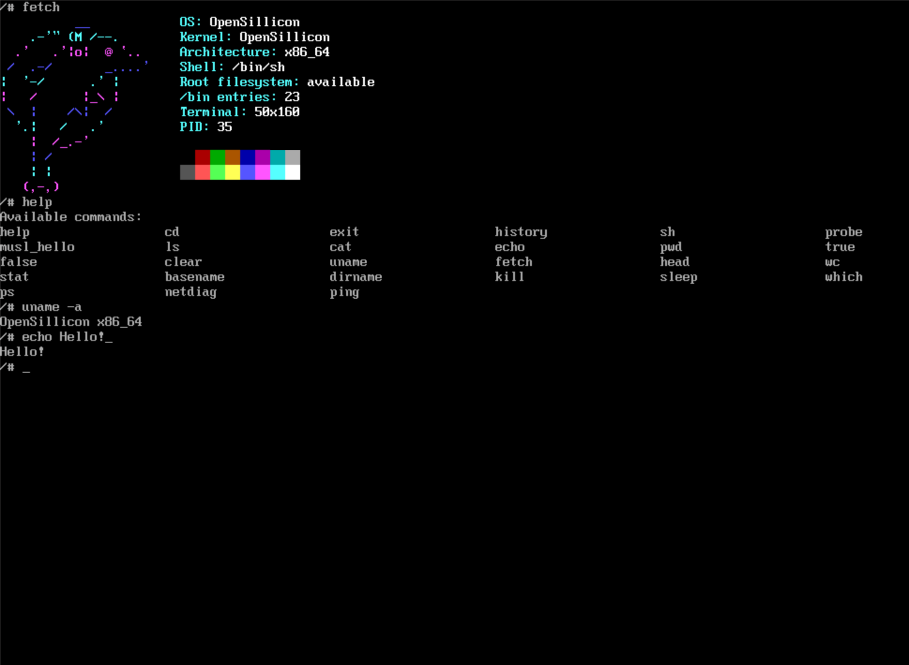

<div align="center">
  
  <h1>OpenSillicon</h1>
  <p><strong>A small x86_64 operating system, built from the ground up.</strong></p>
  <p>Kernel · framebuffer terminal · shell · userspace</p>
</div>

<p align="center">
  
</p>

## Build and run

On a Linux development host with the project’s toolchain, QEMU, OVMF, and ISO utilities installed:

```sh
make -j4 kernel
make run
```

## Build layout

The root `Makefile` is the canonical build entry point. It loads shared defaults
from `mk/common.mk` and the target rules owned by `kernel/Makefile`,
`user/Makefile`, and `tests/Makefile`. The current root targets include `all`,
`kernel`, `iso`, `run`, `run-gui`, `clean`, `acpica-check`, `libos-build`,
`libos-inspect`, and `libos-qemu-test`.

The subsystem Makefiles can also be invoked directly; they re-enter the root
build graph so cross-subsystem dependencies and repository-relative source paths
are handled consistently:

```sh
make -C kernel kernel
make -C user libos-build
make -C tests libos-qemu-test
```

Common overrides are passed on the command line and forwarded to nested Make
invocations. The main build, user image, and libos QEMU fixture honor their output
directory variables. For example, use a separate output tree without touching
`build/`:

```sh
make -j4 kernel BUILD_DIR=/tmp/opensillicon-build
make -C user libos-build BUILD_DIR=/tmp/opensillicon-build \
  LIBOS_BUILD_DIR=/tmp/opensillicon-build/libos
make -C tests libos-qemu-test BUILD_DIR=/tmp/opensillicon-build \
  LIBOS_BUILD_DIR=/tmp/opensillicon-build/libos \
  LIBOS_QEMU_BUILD_DIR=/tmp/opensillicon-build/libos-qemu
```

`CC`, `LD`, `QEMU`, `OVMF_CODE`, `XORRISO`, and the existing subsystem flags
can be overridden the same way. The tests layer currently owns the libos QEMU
fixture and the minimal initramfs artifact. The retained `tests/vfs_test.c` has
no target because its test-only timer stub was removed; the deleted legacy test
sources have no Make targets. `make clean` removes the selected `BUILD_DIR`;
when omitted, it is `build`.

## License

Project code is provided under the [BSD 2-Clause License](LICENSE). Third-party components retain their respective licenses.
