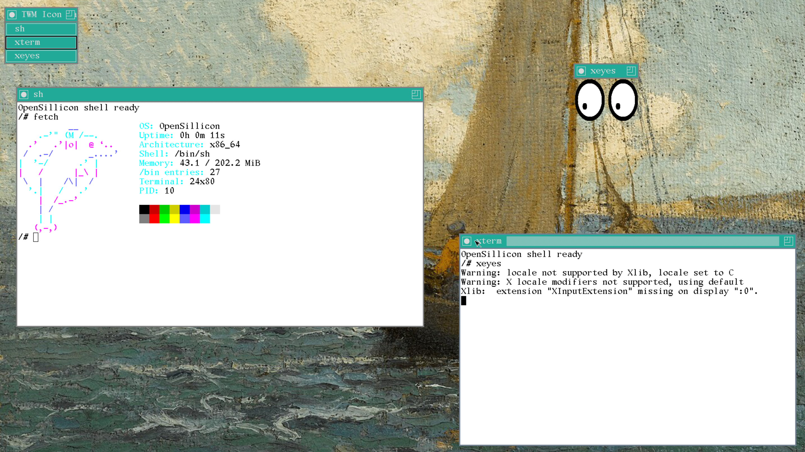

<div align="center">
  
  <h1>OpenSillicon</h1>
  <p>a small x86_64 operating system built from the ground up.</p>
  
</div>

opensillicon is an experimental unix-like operating system with a modular
monolithic kernel and a native userspace.

## what works

- ring 3 processes, elf loading, `fork`/`exec`/`wait`, preemptive scheduling,
  virtual mem, shared mem, signals, pipes, and file descriptors.
- vfs with ramfs, initramfs, devfs, procfs, and the native SilliconFS.
- f/b terminal, ps/2 keyboard, shell, and core utilities.
- native `libos` runtime.
- tinyx session with `twm`, `xterm`, and `xeyes`.
- network stack components for ethernet, arp, ipv4, icmp, udp, and tcp.

## build and run

on a linux x86_64 host, install gcc, gnu binutils, gnu make, py3, qemu-x86 and `xorriso`, then run:

```sh
make
make root      # build the root filesystem image
make run       # serial console
make run-gui   # graphical display
```

## build output and targets

The public goals are `clean`, `iso`, `kernel`, `modules`, `root`, `run`, and
`run-gui`. Plain `make` builds the kernel. File rules handle component
and tool dependencies internally.

Builds show a short status for each kernel, userspace and library component:

```text
[building] building USER pkg/pkg /
[done] USER pkg/pkg (0.2s)
```

On a terminal, the active line rotates through `\ | / -`; parallel jobs
share that line and completed steps get their own status. Redirected output
has plain status lines without terminal escapes. Full commands, warnings and
nested build output are kept under `src/build/logs/<session>/`. A failed step
prints its exit status, the log path and the last diagnostic lines.

```sh
make -j8 root iso          # compact output with a spinner
make V=1 root             # original commands and full build output
make BUILD_SPINNER=0 root  # compact output without animation
```

`BUILD_LOG_DIR=/path/to/logs` changes the log directory. `make clean` removes
the default logs along with the generated build tree. VM output remains live.
Build-output checks can be run with `python3 src/tests/build_output_test.py`.

## source map

- `src/kernel/` - kernel, architecture code, drivers, filesystems, and networking.
- `src/user/` - init, shell, utilities, `libos`, and xorg components.
- `src/include/` - kernel and userspace abi headers.
- `src/tests/` - host and qemu test harnesses.
- `src/tools/` - image and filesystem build tools.
- `src/mk/`, `src/limine/`, and `src/initramfs/` - build rules, bootloader files,
  and the initial ramdisk tree.
- `src/build/` - generated build artifacts.

## license

project code is available under the [BSD 2-Clause License](LICENSE). Vendored
and third-party components retain their respective licenses.
