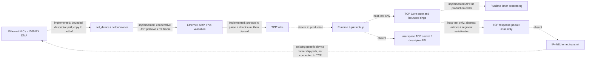

OpenSillicon — Architecture and Design

Version: 1.0
Status: Approved architecture baseline
Architecture: x86_64, modular monolithic kernel
License: BSD-2-Clause

---

1. Project Overview

OpenSillicon is an experimental Unix-like operating system developed from scratch.

The project takes inspiration from BSD operating systems, particularly FreeBSD, for system interfaces, filesystem hierarchy, kernel organization, and userspace conventions.

OpenSillicon is not a FreeBSD fork and does not aim to provide FreeBSD binary compatibility.

Primary goals

- Simplicity and maintainability.
- Good performance.
- Stable and predictable architecture.
- Minimal unnecessary dependencies and abstractions.
- Gradual development through independently testable milestones.
- A practical Unix-like environment.

Target platform

- Architecture: x86_64.
- Bootloader: Limine.
- Boot protocol: Limine Boot Protocol.
- Initial firmware: UEFI.
- Legacy BIOS support: later.
- Kernel language: C11.
- Assembly: x86_64 Assembly, only where necessary.

---

2. Toolchain and Build System

Required tools

- System GCC and GNU binutils capable of targeting x86_64 ELF.
- GNU Make — build system.
- GNU binutils — assembler and linker.
- Limine — bootloader.
- QEMU — virtual machine and testing.
- Git — version control.

Compiler requirements

Kernel compilation must use freestanding options.

At minimum:

- "-ffreestanding"
- "-fno-stack-protector" where required by the early boot environment.
- "-mno-red-zone"
- "-Wall"
- "-Wextra"
- "-Werror"

Kernel and userspace must have separate compiler and linker configurations.

The kernel must not accidentally depend on host operating system headers or libraries.
Use freestanding compiler flags and link without startup files or libraries.

---

3. Kernel Architecture

OpenSillicon uses a modular monolithic kernel.

Kernel execution model

- Kernel runs in Ring 0.
- Userspace applications run in Ring 3.
- Kernel subsystems communicate through internal interfaces.
- Drivers initially execute inside the kernel.
- Static kernel modules are supported first.
- Dynamic module loading may be implemented later.

Kernel design principles

- Keep subsystem interfaces explicit.
- Avoid unnecessary abstraction layers.
- Separate hardware-specific code from generic kernel logic.
- Avoid mixing userspace and kernel responsibilities.
- Prefer small, independently testable components.

Source tree

Use a BSD-inspired source organization.

A proposed layout:

boot/
kernel/
    arch/
        x86_64/
    cpu/
    mm/
    proc/
    sched/
    ipc/
    sys/
    vfs/
    dev/
    net/
    lib/
drivers/
    bus/
    storage/
    input/
    video/
fs/
    ramfs/
    silliconfs/
include/
    kernel/
    arch/
userland/
    init/
    shell/
    bin/
    sbin/
    lib/
tests/
tools/
docs/

The exact directory structure may evolve, but subsystem separation must remain clear.

---

4. CPU, Interrupts and Timers

CPU initialization

The kernel must implement:

- GDT.
- IDT.
- CPU exception handling.
- Interrupt handling.
- TSS.
- Ring 3 transition support.

Interrupt controllers

- LAPIC initializes after the VMM can map its MMIO page.
- Phase 10 validates MADT data through ACPICA and initializes the IOAPIC with
  every redirection entry masked; device IRQ routing is deferred.
- PIC compatibility only where necessary during early boot.

Timers

- LAPIC Timer is the primary scheduling interrupt source.
- The Phase 5 LAPIC timer runs at 100 Hz and is calibrated against PIT channel 2.
- The timer interrupt advances a monotonic tick count and acknowledges the
  LAPIC. HPET and TSC timekeeping remain deferred despite Phase 10 ACPI table
  support.

Scheduling

Initial scheduling model:

- Round Robin.
- Equal priority for all processes initially.
- Kernel initially uses a non-preemptive execution model.
- Kernel threads use cooperative Round Robin switching at explicit yield
  points; timer interrupts do not switch threads.
- Userspace processes are preempted by timer interrupts.
- SMP interfaces should be considered from the beginning.
- Only one CPU is activated initially.

Panic handling

Kernel panic must:

- Print a clear error message.
- Include diagnostic information where available.
- Output through serial logging.
- Stop execution safely.

Kernel debugging symbols must be preserved in development builds.

---

5. Memory Management

Virtual memory

- x86_64 four-level paging initially.
- Kernel occupies higher-half virtual memory.
- Userspace occupies lower-half virtual memory.
- User address spaces must be isolated.
- Kernel mappings must be managed consistently.

ADR-002 defines the address ranges: the existing `0xffffffff80000000` kernel
image base; Limine's runtime HHDM offset for the physical direct map; lower
canonical userspace with the null 64 KiB and top page reserved; vmalloc at
`0xffffc00000000000`–`0xffffe00000000000`; and kernel heap at
`0xffffe00000000000`–`0xfffff00000000000`. The VMM validates arena overlaps
against the boot HHDM span and linked kernel image before using them.
Stage 13C reserves `[0x0000700000000000, 0x00007fffffffc000)` for anonymous
shared mappings. It retains unmapped boundary and inter-mapping guard pages,
uses a monotonic per-address-space cursor, and excludes the range from ELF
segments; see ADR-021.

Physical memory management

Use a bitmap-based Physical Memory Manager (PMM).

Initialization sequence:

1. Read memory map from Limine.
2. Initialize a bootstrap allocator.
3. Initialize bitmap PMM.
4. Initialize Virtual Memory Manager.
5. Initialize kernel heap.
6. Introduce slab allocation later.

Virtual memory features

Planned:

- Page allocation and mapping.
- Address-space creation and destruction.
- Demand paging.
- Copy-on-write.
- Memory protection.
- Page fault handling.

Swap support is deferred.

Allocation failures

Allocation functions must report failure to callers.

The kernel must not silently ignore allocation failures.

Automatic process termination under memory pressure is not permitted until an explicit policy is designed.

---

6. Processes and Userspace

Process model

OpenSillicon uses a Unix-style process model.

Planned system calls:

- "fork()"
- "exec()"
- "wait()"
- "waitpid()"
- "exit()"

The exact semantics and supported flags require an ADR.

Executable format

- ELF64.
- Static linking initially.
- Dynamic linker and shared libraries later.

System call ABI

OpenSillicon will have its own BSD-inspired syscall ABI.

FreeBSD may be used as a reference, but binary compatibility is not a goal.

The syscall ABI must be documented and versioned carefully.

Current ABI version 2 densely renumbers calls by subsystem. The shared
assignments are in `include/abi/syscall.h`; ABI v1 numbering described in the
historical design notes below has been superseded. Argument registers,
interrupt entry, and carry-flag error reporting remain unchanged.

ADR-001 originally defined ABI version 1: `int 0x80`, syscall number/result in `RAX`,
arguments in `RDI`, `RSI`, `RDX`, `R10`, `R8`, and `R9`; success clears CF,
while errors return positive errno in `RAX` with CF set. Initial calls are
append-only: 0 (ABI version), 1 (exit), 2 (write), and 3 (getpid). Phase 6
initially provides serial output descriptors 1 and 2 and a 4096-byte write
limit. Phase 11 binds descriptor 0 to the canonical TTY and routes each
descriptor 1/2 write to the framebuffer terminal and serial console once.
Write also accepts open file descriptors when VFS support is present.

Phase 7 appends `fork` (4), `exec` (5), and `waitpid` (6); `wait()` is
`waitpid(-1, status)`. Phase 8 appends VFS calls 7–11 and `exec_path` (12).
ADR-006 defines eager-copy fork, static ELF exec from a user memory buffer
(syscall 5), static ELF path exec through the VFS (syscall 12), direct-child
wait behavior, and single-threaded processes. Both exec calls replace the
image only after successful loading; syscall 5's ABI remains unchanged.

Phase 8 appends `open` (7), `close` (8), `read` (9), `stat` (10),
`readdir` (11), and static ELF `exec_path` (12). `exec_path` takes a VFS path
in `RDI`, requires an executable regular file, and returns errors without
changing the current image. `write` remains syscall 2. File reads and writes
have a 4096-byte limit; `stat` returns a fixed-width type, mode, and size structure.
`readdir` returns one entry per call, then zero at end of directory. See
ADR-001 and ADR-005 for the ABI and VFS contracts.

Phase 12 appends syscall 13, `sleep_ticks(ticks)`, for init's restart delay.
`RDI` is an unsigned tick count. Zero returns immediately; positive requests
block the calling process until at least that many timer ticks have elapsed.
The scheduler keeps the process off the runnable set while asleep, and the
timer interrupt wakes it without polling. Requests larger than
`UINT64_MAX - current_tick` fail with `EINVAL`, preventing deadline overflow.
No clock query or nanosecond sleep interface is provided.

Phase 13A appends syscall 14, `pipe(fds)`, without changing any existing
syscall number or behavior. It returns a read descriptor and write descriptor
through an 8-byte `uint32_t[2]` at `RDI`. Pipe descriptors use existing
`read`, `write`, and `close`; the 4096-byte ring buffer, short I/O, EOF,
`EPIPE`, failure rollback, descriptor inheritance, and scheduler wait/wakeup
rules are specified in ADR-019. Pipe waits block processes and never busy-wait.
Phase 13A added anonymous pipes. Stage 13B adds only the minimal signals
specified in ADR-020: `SIGINT`, `SIGTERM`, and `SIGKILL`, with append-only
syscalls 15–17. Signal return uses a fixed nine-byte user restorer stub
(`B8 11 00 00 00 CD 80 0F 0B`); the kernel checks its bytes and executable
mapping, active-handler state, and exact syscall return site. Signal state,
delivery, and Ring 3 return selection are serialized with interrupts disabled.
`sigaction` validates and copies input, copies the previous action out, then
commits the new action, so output failure cannot partially change a
disposition. Fork during an active handler fails with `EBUSY`; other fork and
successful/failed exec signal-state rules are in ADR-020. Wait, sleep, and
pipe blocking can be interrupted as specified there. TTY reads are not
interruptible and no TTY blocking redesign is included. Stage 13C adds only
anonymous shared mappings through fork inheritance, using syscalls 18 and 19.
The mappings are zero-filled, RW/NX, and released by detach or address-space
destruction. Fork shares those backing pages while eagerly copying private
pages. Successful exec removes mappings; failed exec preserves them. Zombie
process mappings remain until reap. See ADR-021 for arena, guard, allocator,
and reference-count rules. Named shared memory, unrelated-process attach,
global object IDs, synchronization primitives, read-only mappings, `SIGPIPE`,
job control, terminal-generated signals, and broad libc/POSIX interfaces
remain deferred.

Userspace

The system will provide:

- Minimal init process.
- Basic shell.
- Basic command-line utilities.
- User and group management.
- File descriptor interface.
- Static executable support.

Phase 12 supplies a minimal `/sbin/init` and `/bin/sh` on the persistent
SilliconFS root. The kernel launches init with descriptors 0–2 on the
canonical TTY. For this launch path only, the ELF stack starts with
`argc = 0`, `argv[0] = NULL`, and a null environment pointer. Existing ELF
smoke-test execution keeps its current entry convention. Init supervises the
shell, waits for exit, sleeps ten timer ticks with syscall 13, then restarts
it. Failure to load init is reported over serial and halts the kernel.

The shell keeps `help`, `cd`, and `exit` as shell-specific commands. `ls`,
`cat`, `echo`, `pwd`, `true`, `false`, `clear`, `uname`, and `fetch` are
separate ELF executables in `/bin`. Bare command names resolve under `/bin`; absolute
executable paths are also accepted. Execution uses `fork`, `exec_path_argv`,
and `waitpid`, and reports launch and nonzero-child failures. Shell input is
split on spaces, tabs, CR, and LF; repeated whitespace is ignored. The line
buffer is 256 bytes, with at most 16 tokens. Quotes and backslashes are
ordinary token characters, not quoting syntax; there is no `PATH`, variable
expansion, script language, pipes, redirection, or job control. For an
external command, `argv[0]` is the command token exactly as typed, while the
resolved executable path is looked up separately (`/bin/<name>` for a bare
name). Syscall 27 accepts 1–16 arguments and at most 2048 aggregate bytes
including NUL terminators. It installs `argc`, `argv`, a null `argv[argc]`, a
null `envp`, and the existing auxv on a 16-byte-aligned initial stack. The
custom startup stub passes argc, argv, and the initial-stack pointer to
`user_main`; no environment vector is supported. The older path-only
`exec_path` continues to launch with argc zero. `pwd` reports `/`, since
there is no cwd process state or environment interface. Path operands accepted
by `ls` and `cat` treat relative paths as rooted at `/`; shell `cd` does not
change a child process working directory because no cwd syscall exists.

The framebuffer console recognizes a bounded ANSI CSI subset. SGR supports
reset (`0`), standard foreground (`30`–`37`) and background (`40`–`47`), and
bright foreground/background (`90`–`97`, `100`–`107`) using the 16-color
palette. The parser retains state across writes, has two bounded parameters,
and drops malformed or unsupported control sequences. It is not a full
VT/xterm emulator. Coreutils do not emit decorative colors because there is
no terminal-detection syscall. Kernel boot status lines color only `*` blue,
keep `Initializing <component>` white, and color `[ OK ]` green or `[ ER ]`
red. Component names use a fixed-width field so status tokens align. ANSI
resets follow each colored segment. Status lines are buffered until the
framebuffer console is ready. Kernel smoke-test stdout remains serial-only;
framebuffer stdout is enabled when `/sbin/init` starts. Status lines
correspond to reached success paths or failure branches.
`process_system_init` has no failure path or return value;
it resets process state without allocating resources, then the boot log reports
that initialization step as complete.

The bounded coreutils set is `ls`, `cat`, `echo`, `pwd`, `true`, `false`,
`clear`, `uname`, `fetch`, `head`, `wc`, `stat`, `basename`, and `dirname`.
The process utilities are `kill`, `sleep`, `which`, and `ps`: `kill` supports only
SIGINT, SIGTERM, and SIGKILL; `sleep` accepts whole seconds using the current
100 Hz timer; `which` searches `/bin` or checks an explicit path. `ps` uses
the bounded syscall 28 snapshot (PID, PPID, state, status; at most 128
processes) and does not report command names because the kernel does not retain
them.
`head` supports `-n N`; `wc` supports `-l`, `-w`, and `-c`; `stat` reports
available vnode type, size, and mode metadata. `ls` and `cat` accept path
operands; relative paths are rooted at `/` because processes have no cwd.
`fetch` displays runtime root availability, `/bin` entry count, terminal size,
and PID alongside OS and architecture labels. File mutation commands
(`mkdir`, `rm`, `rmdir`, `touch`,
`cp`, `mv`) await corresponding VFS syscalls. `tail` is deferred because the
VFS has no seek operation and bounded streaming support has not been added;
`yes` is omitted because no pipe or
redirection interface can contain its output. `date` has no clock query, and
`whoami` has no kernel credential interface.
`/etc/passwd` and `/etc/group` provide descriptive root and regular-user
records only. No login, authentication, kernel UID/GID, privilege separation,
or permission enforcement is added. rc.d and persistent logging are deferred.

C library

musl is the intended userspace C library.

Stage 14 selects a native OpenSillicon musl port, adapted to the existing
OpenSillicon syscall ABI. This does not provide Linux syscall compatibility.
The initial profile is static x86_64 programs; the exact libc/syscall surface
and runtime prerequisites remain subject to ADR-022 and later Stage 14
decisions. Dynamic linking, shared libraries, PIE/ASLR, threads, futexes, and
broad Linux compatibility remain deferred. ADR-023 defines the static ELF
startup stack and single-thread PT_TLS/FS-base lifecycle. ADR-024 pins musl
1.2.6 as the source-verification baseline and records the x86_64 TCB/TLS,
startup, auxv, and representative static ELF findings. This pin is not
approval to ship the release unchanged. ADR-025 records a reviewed security
patch series and validation limits; the patched source is a development and
porting baseline only, not distribution-qualified. Musl initializes its
user-space TCB/TLS and invokes an upstream Linux-specific FS setter. ADR-031
defines OpenSillicon's native syscall 20 `set_fs_base` and implements
PT_TLS validation plus process FS-base handling across interrupt return,
fork, and exec. This is a kernel TLS foundation, not a musl port: native
syscall adaptation, larger TLS allocation, and the musl startup path remain
unfinished. ADR-026 proposes the source, target, syscall-adapter,
private-memory, VFS, and sysroot integration architecture. No Linux syscall
compatibility is introduced.

Threads

- Kernel threads are planned.
- POSIX threads are deferred until the process model is stable.

---

7. IPC and Synchronization

Initial IPC mechanisms:

- Pipes.
- Signals.
- Shared memory.

Signals should follow a POSIX-like model.

File descriptors are the common interface for userspace I/O.

Synchronization primitives must be designed with interrupt context and future SMP support in mind.

The exact synchronization model requires an ADR.

---

8. Users, Permissions and Security

User model

- Root user has UID 0.
- Regular users have separate UIDs.
- Groups use GIDs.
- BSD-like account conventions.
- "/etc/passwd"
- "/etc/group"

File permissions

Use Unix-style permissions:

- Owner.
- Group.
- Others.
- Read, write, execute.

Capabilities are not part of the initial design.

ASLR is a future security feature.

Secure Boot is not a requirement.

---

9. VFS and Filesystems

Virtual File System

Implement a full VFS abstraction under ADR-005.

Use a BSD-like vnode model.

Important distinction:

- A vnode is an active VFS representation of a filesystem object.
- An inode is a persistent filesystem-specific object.

They are related, but they are not interchangeable.

The VFS must provide a consistent interface for:

- File operations.
- Directory operations.
- Mounting.
- File metadata.
- Permissions.
- Path resolution.

The Phase 8 baseline uses reference-counted vnodes and open-file descriptions,
mount-aware absolute path lookup, a writable RAMFS root, and a read-only
`newc` initramfs mounted at `/init`. Phase 10 replaces the RAMFS root with
SilliconFS before userspace starts while retaining the initramfs backing data.

SilliconFS

SilliconFS is the native OpenSillicon filesystem.

Initial design:

- Inode-based.
- 4 KiB logical filesystem blocks.
- Little-endian on-disk format.
- Versioned format.
- Feature flags for future extensions.
- No journaling initially.
- Unix-style permissions.
- BSD-like mount model.

The filesystem must be designed to support future expansion without breaking older disk images unnecessarily.

SilliconFS v1's exact little-endian 4 KiB on-disk layout, 128-byte inode,
bitmap geometry, direct/single-indirect mapping, variable-length directory
records, validation rules, and limits are specified by accepted ADR-003 in
`OPEN_ADRS.md`. Phase 9 uses one-block read/write callbacks so host disk-image
tests and VFS mounting do not depend on hardware discovery. Phase 10 adds the
general block-device layer and AHCI driver.

Block device considerations

Filesystem block size and physical disk sector size are different concepts.

Phase 10 supports devices with 512-byte or 4096-byte logical sectors.
Physical-sector reporting for 512e and 4Kn devices is deferred.

A 4 KiB filesystem block must not imply that every disk uses 4 KiB sectors.
The Phase 9 callback addresses filesystem blocks; the Phase 10 block adapter
translates those operations to device sectors using aligned bounce storage.

Initial filesystems

- initramfs.
- RAMFS.
- SilliconFS.
- devfs at `/dev` and procfs at `/proc`.

After SilliconFS becomes the root filesystem, the kernel creates `/dev` and
`/proc` mountpoint directories and mounts devfs and procfs before launching
`/sbin/init`. Mount errors are logged; boot continues with the affected
mountpoint left intact. Existing non-directory paths are not replaced.

devfs exposes only implemented interfaces: `/dev/console` reads from the TTY
input path and writes to both TTY output and serial; `/dev/null` returns EOF
and discards writes; `/dev/zero` supplies zero bytes and discards writes.
Device nodes are character devices. Seek is unsupported. No hardware device
nodes are published until a corresponding usable driver interface exists.

procfs currently exposes `/proc/self`, a per-open snapshot containing the
current process PID, parent PID, scheduler state, and exit status, plus
`/proc/uptime`, a per-open snapshot of timer ticks formatted in seconds to
hundredths. These values come from existing process structures and the 100 Hz
timer. Process enumeration, process names, command lines, memory maps, and
per-process directories are unavailable because the kernel does not yet
provide the necessary stable enumeration and metadata interfaces.

Phase 10 uses Limine's RSDP to initialize pinned ACPICA with an OpenSillicon
OSL. PCI enumeration is read-only, using configuration mechanism 1 as a
fallback and ACPI MCFG ECAM when available. ACPICA provides MADT through its
table manager; the x86_64 ACPI adapter validates and consumes the MADT entries
needed to initialize the IOAPIC. Existing LAPIC, PIC masking, IDT, and timer
initialization remain in place; IOAPIC redirection entries start masked.
ACPICA power management and events are deferred.

The minimal block layer uses synchronous logical-sector reads, writes, and
flushes with negative errno errors. It supports 512-byte and 4096-byte logical
sectors and keeps sector size independent from the 4 KiB SilliconFS block
size. AHCI runs serialized polling commands with validated DMA constraints;
NCQ, async queues, and caching are deferred. Phase 10 mounts and validates
SilliconFS before userspace, replaces RAMFS at `/`, and keeps initramfs mounted
at `/init` with Limine-owned backing memory valid for all outstanding VFS
references.

---

10. Device Drivers

Initial hardware support

Priority order:

1. Serial output.
2. Limine framebuffer.
3. Keyboard.
4. Basic input infrastructure.
5. PCI enumeration.
6. AHCI storage.

Bus support

PCI/PCIe enumeration must be implemented early.

USB support is deferred.

Storage

Initial storage target:

- AHCI SATA.

Later:

- NVMe.

Input

Phase 11 input uses a polled i8042 PS/2 keyboard. The driver decodes
translated Set 1 scancodes into key events; a separate US keymap handles
Shift, Caps Lock, and Control and produces terminal input. Polling must yield
with `sti; hlt; cli` between attempts while a canonical read is blocked, so
the existing LAPIC timer wakes the CPU without a busy-spin. Keyboard IRQ
routing, mouse input, and USB HID are deferred. If the i8042 controller is
missing or initialization fails, log the failure and leave keyboard input
unavailable while retaining serial and framebuffer output.
Initialization waits use the same timer-driven sleep and time out after 100
ticks (one second at the approved 100 Hz timer rate).

Audio

Audio is not required for the initial system.

---

11. Graphics, TTY and Terminal

Framebuffer

Use the framebuffer provided by Limine during early development.

A separate VESA/GOP driver is not required initially.

Implement an OpenSillicon framebuffer API.

Terminal

Phase 11 provides four virtual terminals. Each owns its screen cell buffer,
cursor and parser state, canonical input line, and completed-input queue.
Alt+F1 through Alt+F4 switches the active terminal without discarding screen
or input state. The initial renderer uses Limine's RGB framebuffer and a
built-in 8-by-16 bitmap font (Modern DOS, CC0 1.0). It supports newline, carriage return,
backspace, tab, scrolling, CSI `2J`, `H`, `K`, and SGR reset, standard 8-color,
and bright 8-color foreground/background sequences.

Standard input is a canonical TTY: Enter queues the line with a newline;
backspace edits the current line; Ctrl-D on an empty line delivers EOF, while
Ctrl-D on a nonempty line queues that line without inserting Ctrl-D or a
newline. The line buffer is 256 bytes including newline, and excess input is
rejected without overwriting buffered data. Standard output is routed once
through a console fan-out to the active framebuffer terminal and serial.
Kernel diagnostics continue through the serial logger directly. Unicode,
termios, signal delivery, mouse input, and TrueType fonts remain deferred.

Graphics architecture

The long-term goal is support for a real Xorg server.

OpenSillicon will not initially develop its own X11 server or compositor.

A DRM/KMS-like interface may be introduced later.

This does not imply Linux DRM driver compatibility.

Framebuffer support alone does not mean Xorg is ready to run.

---

12. Initialization and Services

Use a BSD-inspired startup model.

Planned:

- Own minimal init.
- Supervise and restart the shell after a timer-based delay.
- Basic account initialization.
- Start from the mounted persistent SilliconFS root.
- Keep serial diagnostics separate from terminal output.

BSD-style rc.d services and persistent syslog-like logging are deferred until
the system has services and a logging facility. Phase 12 account files are
metadata only; authentication and permission enforcement are not implemented.
The initial userspace must remain minimal.

---

13. Networking

The first bounded Ethernet II/ARP/IPv4/ICMP implementation now exists on top
of the QEMU e1000 driver. It validates untagged Ethernet II frames, maintains
an eight-entry expiring ARP cache, handles local ARP requests, and validates
IPv4 ICMP Echo messages with checksums. Static test configuration is
10.15.3.1/24 at MAC 52:54:00:15:03:01; its isolated peer is 10.15.3.2 at
52:54:00:15:03:02. The QEMU test sends an ARP request and ICMP Echo Request
and receives a matching Echo Reply through actual e1000 DMA rings. This is
not yet a continuously serviced production interface. Bounded UDP and
project-native socket descriptors have since been added for the QEMU profile.
TCP currently has an isolated, host-tested wire/state-machine core only; it is
not connected to netstack, e1000, timers, descriptors, or syscalls. Live TCP
connections and a TCP socket API remain unavailable. DHCP, IPv6, routing,
forwarding, fragmentation, and VLAN remain unimplemented.
ADR-036 defines the broader bounded native stack architecture: an e1000 QEMU first driver,
Ethernet/ARP/IPv4/ICMP/UDP/TCP,
static IPv4 configuration and routing, and sockets as refcounted descriptors
through the existing FD layer. The initial device path is polled from deferred
kernel context; interrupt handlers must not parse packets or wake sockets.
The initial profile excludes IPv6, DHCP, forwarding, fragmentation, and Linux
socket ABI compatibility. See ADR-036 for packet ownership, protocol limits,
socket semantics, prerequisites, and the staged test plan. The first
foundations include a fixed packet pool, a generic device ownership contract,
read-only decoding of assigned PCI BAR type/address, a bounded PCI MMIO
mapping lease for resources with a separately validated aperture, and
contiguous DMA allocations with explicit CPU/device ownership. Generic BAR
apertures remain unknown: live probing is not performed because there is no
PCI device-claim/quiesce lifecycle. MMIO leases accept validated ranges fully
covered by RESERVED memory or wholly absent from Limine's memory map, while
rejecting any overlap with described RAM/boot ranges. They use uncached
mappings in the reserved vmalloc window and can be released.

DMA identity addressing is enabled only when Limine honored the requested
base revision 5 and reports loaded revision 5 or newer; the kernel does not
request `LIMINE_X86_64_KEEP_IOMMU`. Otherwise DMA allocation and DMA-dependent
drivers are disabled. This does not provide IOMMU translation or cache
maintenance for non-coherent platforms; those profiles are unsupported. DMA
allocations are contiguous, zero-filled, alignment/address-width bounded, and
cannot be freed while device-owned or pinned by an active descriptor ring.
Descriptor ownership is tracked per slot; publish/completion barriers order
coherent x86 DMA memory and MMIO notifications. A caller must confirm a
device-specific stop/reset before ring memory is unpinned. The supported
QEMU-only e1000 profile now configures eight 16-byte TX and eight 16-byte RX
descriptors (128-byte rings aligned to 128 bytes) with separate 2048-byte DMA
buffers. Bus mastering is enabled only after DMA contract validation, buffer
allocation, ring publication, and ring register programming. Polling TX/RX
passes one host-peer Ethernet smoke exchange in QEMU; this does not implement
or validate Ethernet protocol processing, general hardware support, or
non-coherent/IOMMU DMA.

The bounded QEMU preparation profile is q35 with `-nic none`, explicit
`-device e1000`, and an isolated socket peer for the frame test. QEMU 10.2.2
reported
`8086:100e`, BAR0 128 KiB non-prefetchable 32-bit MMIO, BAR1 64-byte I/O, and
an unassigned expansion ROM. This is a QEMU profile, not generic PCI sizing;
the guest validator rejects other IDs/layouts and does not probe BARs.

Milestone 15.2A connects that profile to guest PCI enumeration. It validates
the BAR layout, enables memory decode while clearing bus mastering, maps BAR0
through an uncached lease, performs a bounded CTRL.RST poll, and validates
CTRL/STATUS. Guest QEMU logs verify these steps. Milestone 15.2B adds bounded
DMA rings and a polled raw Ethernet TX/RX path; the test-only guest smoke build
is verified against a host socket peer. Interrupt-driven I/O, protocol parsing,
protocol processing and general socket service remain limited. ADR-039 records
the exact ring lifecycle and evidence. Milestone 15.3A adds bounded
Ethernet/ARP/IPv4/ICMP parsing and a
peer-verified QEMU Echo exchange; ADR-040 records the supported profile and
limitations. Milestone 15.3B adds validated IPv4 UDP datagrams and a
project-native socket-as-FD API over syscalls 28–31; see ADR-041 for wire,
queue, endpoint, reference-lifetime, and timeout semantics. It is a static
`10.15.3.1/24` profile on the supported e1000 device, with no TCP or POSIX
socket compatibility.

Milestone 15.4B adds an isolated TCP state model in
`kernel/net/tcp/tcp_core.c`. Phase 15.4R separates bounded wire parsing and
serialization into `kernel/net/tcp/tcp_wire.c`; the core's compatibility helpers
delegate to that module. It supports the eleven modeled states, IPv4
pseudoheader checksums, MSS/NOP/EOL options, ACK and sequence checks, in-order
receive data, and explicit actions for future packet output.
Limits are eight connection slots, four pending children per listener, 2048
queued receive bytes per connection, 1480 bytes per segment, five modeled
control retransmission attempts, and 12000 timer ticks in TIME-WAIT. Table
handles use generations and external references so closed entries are not
reused while held by a caller. The model does not perform packet I/O. Listener
creation, active-open events, and their explicit deterministic sequence seed
are compiled only with `TCP_CORE_TESTING`; these event variants and the seed
field are absent from the production kernel object. The
15.4I RDRAND API is not integrated with this model, and current QEMU test
profile reports it unavailable; TCP remains disabled
on the live network path, with no TCP syscall/API, runtime timer hook, data
retransmission, or end-to-end verification. Milestone 15.4C adds an isolated
bounded service primitive that progresses at most four due control or
TIME-WAIT timers per call and returns retained handles/actions to a future
deferred network service. Control RTO starts at 100 ticks, doubles to 800
ticks, and aborts after five retries; TIME-WAIT is 12000 ticks. The timer
source is 100 Hz, and comparisons handle uint64 wraparound. This service is
not called by the timer interrupt or current UDP poll path. The later 15.6A.1
boot path requests Limine entropy and inspects the bounded response; the
protocol defines it as best-effort and permits timing-seeded fallback, so it
is not accepted as a trusted ISN source.

Milestone 15.4I adds a bounded kernel random-byte API backed directly by the
CPU RDRAND instruction when CPUID leaf 1 advertises it and the instruction
returns valid output. Intel documents its RDRAND output as CTR_DRBG-based;
this kernel does not establish equivalent implementation or trust properties
for every vendor or hypervisor. The kernel checks CF, retries at most ten
times, and latches the API unavailable after initialization or runtime source
failure. Requests are all-or-nothing,
limited to 256 bytes, and run with local interrupts masked to prevent
single-CPU timer-preemption reentrancy. This is not SMP synchronization and
does not provide independent software state, a reseed policy, or protection
against a faulty or malicious CPU, firmware, or hypervisor. A successful
feature check is a capability signal, not proof of source quality. The
default QEMU CPU profile used by current tests omits `-cpu` and reports the
random source unavailable; UDP networking continues to boot and operate. A
separate QEMU TCG boot with `-cpu max` returned successful random-source
initialization, confirming feature detection and a valid RDRAND result in that
emulated profile only.
`tcp_core_live_isn_available()` remains false and the random API is not wired
to TCP. Deterministic source injection exists only in the host test build.
There is still no live TCP packet or syscall path.

Milestone 15.4J reviewed whether to add a software DRBG. It was deferred:
the kernel has no reviewed ChaCha20/AES/hash implementation to reuse, and
adding a new primitive plus seed conditioning, reseed limits, and state-update
policy would expand the cryptographic code surface without improving the
current default QEMU profile, which has no exposed RDRAND. RDRAND is treated
as a separate hardware DRBG interface, not as interchangeable with RDSEED.
Intel identifies RDRAND at CPUID.1:ECX[30] and RDSEED at CPUID.7:EBX[18]; the
kernel currently checks and executes only RDRAND. RDSEED is not part of the
implemented policy. No software seed size, software state, or reseed policy
is therefore claimed. If a reviewed software DRBG is proposed later, it must
define those requirements and fail closed on absent/failed seed acquisition.
This decision leaves production TCP ISNs and live TCP disabled.

The hardware trust boundary is platform-specific. Intel's DRNG guide describes
Intel RDRAND as CTR_DRBG output and RDSEED as seed material for software DRBGs;
those implementation claims are not generalized to every vendor. AMD's
programmer manual defines its instruction feature/CF interface, while AMD's
SB-7055 documents an RDSEED defect on affected Zen 5 systems where CF could
indicate success for a bad result. Thus CPUID and CF establish the documented
instruction interface, not entropy quality or universal vendor correctness.
QEMU can suppress or expose these CPUID features and emulate the instructions;
the guest has no current mechanism to distinguish that from bare metal or
verify the host entropy source.

The observed QEMU 10.2.2 profile matrix is: default (no `-cpu`) reports
unavailable; `-cpu max` reports initialization success;
`-cpu max,-rdrand` reports unavailable; `-cpu max,-rdseed` still reports
success; and `-cpu max,-rdrand,+rdseed` reports unavailable. The last profile
explicitly configures RDSEED on while RDRAND is off, but this kernel does not
read guest RDSEED CPUID state. The results confirm that the kernel consults
RDRAND only and does not fall back to RDSEED. `run-gui` and
the UDP QEMU fixture do not use `-cpu host` or host passthrough. The default
model is QEMU's compatibility model, documented as `qemu64` for x86_64 when
no CPU option is specified. These emulation results test feature handling,
not production entropy quality.

Source policy: RDRAND is an implemented but conditional hardware DRBG
interface, not a universal OS CSPRNG; RDSEED is not implemented; Limine entropy
is requested but rejected as a trusted source because the protocol is
best-effort; no external RNG device is supported; deterministic injection is
host-test-only and never production entropy. No kernel caller currently uses
`kernel_random_bytes()`. Keep production security-sensitive use unavailable
until a platform trust policy defines acceptable CPU/hypervisor configurations
and a separately reviewed software CSPRNG has a defensible seed and reseed
policy. This applies to ISNs, keys, tokens, and any future userspace random
API.

Milestone 15.4F adds a fixed eight-entry deferred network event queue. The
service drains at most four events per call, with each RX-poll event processing
at most one frame through the existing UDP/netstack path. It runs at generic
syscall entry and after the blocked-process scheduler idle path wakes from
`hlt`; it does not run in the LAPIC timer handler. The existing UDP syscall
poll remains, with a single-owner guard preventing recursive RX polling.
Shutdown refuses while the service is running or work remains queued. This is
bounded cooperative progress, not a background worker: a user process that
runs without syscalls is not serviced during timer preemption. The TCP timer
primitive is still not connected because no runtime-owned TCP table/lifecycle
exists. The conditional RDRAND API is not an ISN source here, so live TCP
remains fail-closed.
Kernel threads are cooperatively scheduled and the runtime has no network
event-wait primitive, so this milestone does not add a worker or alter the
scheduler to create one. Requests are not coalesced: a full queue rejects only
the new request and preserves its eight queued indications. Runtime safe
points run the service even when enqueueing was rejected, so repeated safe
points drain a saturated queue within the four-event budget; no progress is
promised if safe points stop occurring.

### TCP core readiness (Phase 15.4L)

The isolated TCP table now models connection identity as the complete local
IPv4 address, remote IPv4 address, local port, and remote port tuple. Duplicate
active tuples are rejected. Listener entries use remote port zero and require
a zero remote address; a listener may bind a specific local address or
`0.0.0.0`. Same-port listener binds conflict when either address is wildcard
or both specific addresses match. Lookup selects an exact live tuple before a
matching listener, reports ambiguity rather than selecting arbitrarily, and
returns a retained generation-tagged handle that the caller must release.
Tuple snapshots require a currently valid handle. Callers must externally
serialize table operations; this core has no internal lock or SMP guarantee.

The parser accepts a bounded IPv4 TCP segment view and validates its
pseudoheader checksum, but the caller must first validate the enclosing IPv4
header and packet bounds. Current `netstack_process_frame()` classifies only
ICMP and UDP; it ignores IPv4 protocol 6, so no live TCP dispatch exists.
Future dispatch must validate Ethernet and IPv4, classify TCP, parse and
checksum the segment, look up its four-field tuple/listener, step the core,
then translate bounded actions into output packets.

TCP actions are values, not packet ownership transfers. A parsed segment's
payload pointer borrows the caller's input bytes only for the duration of the
step. Accepted in-order bytes are copied into the fixed per-connection
2048-byte receive buffer; no action retains an RX DMA pointer. Actions such
as SEND_SYN, SEND_ACK, SEND_FIN, SEND_RST, and RETRANSMIT describe future
output but contain no serialized packet. A future integration must build an
owned frame and follow the network device's CORE-to-DEVICE transfer and
completion rules. The current e1000 TX API has not been connected to TCP
actions.

The table has eight fixed slots. Creation returns one external reference;
active/listening entries acquire table ownership, and passive SYN children
are table-owned and returned with a caller reference. Closed entries are
reclaimed only after table ownership and all external references are gone.
Timer service results likewise carry references that callers release. The
core requires external serialization for create, lookup, retain/release,
step, read, and timer service. It has no runtime-owned table or shutdown hook.
Production entropy remains unavailable under the current platform policy:
`tcp_core_live_isn_available()` is false, explicit active-open seeds remain
for deterministic model tests only, and live TCP, packet dispatch, syscalls,
and timer integration remain disabled.

### TCP runtime ownership and IPv4 classification (Phase 15.4N)

`tcp_runtime` now owns one private, fixed-size TCP model table. Boot initializes
it once after the existing UDP stack and cooperative network service are ready;
there is no production API to create a listener or connection, and no table
internals are exposed. Initialization is one-shot and fails on duplicate
calls. The table has no dynamic allocations or fallible sub-steps, so there is
no partial allocation state to unwind. Shutdown is also explicit and
one-shot: it first enters STOPPING, rejects further runtime work, and refuses
completion while any table entry or external handle remains. It never forcibly
invalidates a handle. The UDP QEMU test exercises this refusal/release/shutdown
contract before asking the existing service to drain and stop e1000. Production
currently has no TCP handle-creation path, so its table stays empty.

The bounded `netstack_ipv4_classify()` helper validates an option-free IPv4
header, total length against both the available frame bytes and configured
MTU, and the IPv4 header checksum before classifying ICMP (1), TCP (6), UDP
(17), or unsupported protocols. It rejects null/short input, a wrong version,
unsupported or truncated IHL/options, undersized/oversized totals, and bad
header checksums. The existing `process_ipv4()` path still rejects fragments,
invalid TTL/address/MAC, and nonlocal destinations before transport handling.
For protocol 6 it then validates the bounded TCP wire format and IPv4
pseudoheader checksum using `tcp_wire_parse()`; malformed or truncated TCP is
classified as invalid. A valid segment receives only `NETSTACK_TCP_DISABLED`.
It is not passed to `tcp_segment_parse_ipv4()`, tuple lookup, or
`tcp_core_step()`, and no response, connection, or work item is created. The
future dispatch insertion point is immediately after this validation in
`process_ipv4()`, while the single existing `udp_socket_poll()` call owns the
RX packet; validation must finish before its CORE-owned netbuf is released.

RX ownership is unchanged: deferred network service and UDP syscall polling
share the existing guarded `udp_socket_poll()`/netstack path, with no TCP poller
and no second device receive. UDP still copies payload into its fixed
socket-owned datagram slot before the RX packet is released; each socket keeps
its four-datagram queue limit. The UDP host regression injects a checksum-valid
TCP SYN and confirms it does not appear in a bound UDP queue. A future TCP service must reserve bounded timer
work on every invocation, process only a bounded RX/event batch, run outside
the LAPIC interrupt handler, preserve single-owner serialization, and release
each timer-service returned handle. Cooperative service still cannot promise
progress while userspace runs without entering the kernel. Shutdown must stop
new TCP work, drain/reject pending work, prove all references are released,
then destroy the logical table; e1000 DMA teardown remains separately gated
on device quiescence. Production ISNs remain unavailable because the entropy
policy is fail-closed; the current RDRAND wrapper is not wired to TCP.
Host-only synthetic SYN/SYN-ACK/ACK fixtures exercise parser,
tuple-selection, and core-state behavior as described below; they cannot
establish live handshake support or justify production sequence numbers.

### Isolated TCP handshake control plane (Phase 15.4P)

The host-only TCP core now exercises active and passive connection
establishment using explicit deterministic event seeds. Active open enters
SYN-SENT and requests one SYN. It accepts a SYN-ACK only with the exact
expected acknowledgment (`SND.NXT`), no payload, and the supported SYN|ACK
flags; it records the peer sequence and returns one final ACK action. A bare
SYN in active SYN-SENT enters active-origin SYN-RECEIVED; a matching peer
SYN-ACK completes the simultaneous-open model and emits the final ACK.
Unexpected ACKs,
wrong acknowledgments, payload before establishment, unsupported control-flag
combinations, and tuple mismatches leave the handshake unadvanced.

Passive open accepts a SYN-only segment at a listening tuple, creates a child
with the exact four-field peer/local tuple, enters SYN-RECEIVED, and emits a
SYN-ACK action. The listener remains listening. An exact duplicate SYN
reissues the bounded SYN-ACK actions without another child. The final pure ACK
must exactly match `SND.NXT` and `RCV.NXT`, contain no payload, and have no
other flags before the child enters ESTABLISHED. Four SYN-RECEIVED children
per listener are allowed within the global eight-slot table; excess backlog
or allocation pressure fails without allocation and requests the modeled RST
action.

For these handshake states, active SYN-SENT RST closes only for exactly
RST|ACK with the exact outstanding acknowledgment; SYN-RECEIVED accepts only
RST or RST|ACK at exact `RCV.NXT`. Outside SYN-SENT, the ACK field does not
validate a reset. Removing a passive child leaves its separate listener in
LISTEN; an active-origin SYN-RECEIVED reset closes the active entry. In
synchronized states, RST sequence numbers are accepted anywhere in the
bounded receive window. This does not implement RFC 5961 challenge ACKs for
in-window but non-exact resets. Extra RST flag combinations are ignored.
Control retransmission starts at 100 ticks, backs off to a maximum of 800
ticks, emits at most five retransmission actions, then closes on retry
exhaustion. A duplicate FIN in TIME-WAIT is ACKed and restarts the fixed
12000-tick timer. Timer service remains isolated and returned handles must be
released. Sequence ordering uses modulo-2^32 serial comparisons for ranges
smaller than 2^31; the receive model accepts only fully in-order segments and
does not trim old prefixes or queue future segments.

Host fixtures construct IPv4/TCP packets, verify IPv4 total length/header
checksum and TCP pseudoheader checksum, then feed parsed views to the isolated
state machine. Tests include checksum and pseudoheader failures, truncation,
data-offset and total-length errors, duplicate SYN, incorrect ACK/sequence,
unknown well-formed option handling, simultaneous open, RST validation,
duplicate SYN-ACK/final ACK, serial-number boundary cases, and TIME-WAIT
restart/expiration. These tests do not transmit any packet. The production
IPv4 receive path invokes the TCP Wire parser for validation and then discards
the segment; it does not call `tcp_core_step()`. There is no TCP syscall or TX
path and no approved production ISN source. `tcp_core_live_isn_available()`
remains false; this bounded model is not a standards-complete TCP
implementation.

RFC 9293 audit (Sections 3.3, 3.3.2, 3.4, 3.5.2–3.5.4, 3.9, and 3.10.7;
reference: <https://www.rfc-editor.org/rfc/rfc9293.html>):

| Feature | RFC requirement | Current model | Status | Required action |
|---|---|---|---|---|
| §3.3 sequence space | Modulo-2^32 arithmetic; SYN/FIN each consume one; validate ACK and receive-window overlap | Serial comparisons are wrap-safe for bounded spans; handshake SYN consumption and boundary tests exist. Receive accepts only exact in-order data and rejects overlap/out-of-order data rather than trimming/queuing. Data on SYN is unsupported. | Partially implemented | Add segment trimming/reassembly and support or explicitly negotiate SYN data before claiming conformance. |
| §3.3 TCP options | Parse mandatory options and ignore unknown well-formed options | MSS/NOP/EOL parsed; unknown length-delimited options are skipped; malformed lengths are rejected. Reserved nibble is preserved/ignored; ECN and URG semantics are unsupported. | Partially implemented | Negotiate and implement extensions only with their complete semantics. |
| §3.3.2 state machine | State-specific event transitions | Eleven states are represented; common handshake and close paths are modeled, not the complete RFC event table. | Partially implemented | Complete state-specific packet/event processing and verify all transitions. |
| §3.4 establishing | Active/passive handshake and simultaneous open | Active, passive child, and simultaneous-open transitions are deterministic host-tested. No production ISN source, runtime listener, or packet path exists. | Requires runtime integration | Add trusted ISN policy, one runtime owner, dispatch, and packet output before live connections. |
| §3.5.2 reset generation | Generate state-appropriate reset sequence/ACK fields | Core returns only `TCP_ACTION_SEND_RST`; it does not build the reset segment or its SEQ/ACK fields. | Requires runtime integration | Add RFC state-aware reset packet construction and peer-fixture validation. |
| §3.5.3 reset processing | Validate reset sequence; SYN-SENT uses ACK of SYN; passive SYN-RECEIVED returns to LISTEN, active SYN-RECEIVED closes | SYN-SENT validates ACK; SYN-RECEIVED uses exact sequence in this model; synchronized and TIME-WAIT states accept exact `RCV.NXT`, abstractly challenge non-exact in-window RST, and ignore out-of-window RST. Passive child removal preserves listener. | Partially implemented | Complete state-specific reset handling and build a correct response only with retained packet context and an output path. |
| §3.5.4 closing | Correct FIN sequence consumption and close-state transitions | Common FIN-WAIT/CLOSE-WAIT/CLOSING/LAST-ACK/TIME-WAIT paths and timer expiry are tested. Queue draining, application notification, and combined data/control cases are incomplete. | Partially implemented | Complete the transition matrix, queued-data semantics, and API notifications. |
| §3.9 interfaces | TCP/user and TCP/IP interfaces | No TCP user API, syscall, or live lower-layer handoff is in scope. | Not applicable to current scope | Define the native socket and IP handoff in a later approved milestone. |
| §3.10.7 arrival processing | Ordered state-specific sequence, RST, SYN, ACK, data, and FIN processing | Bounded subset processes handshake controls, in-order data, resets, and close events. Zero-length sequence acceptability uses the receive window; future ACKs request ACK; ACKs are bounded by sent range; WL1/WL2 freshness is tracked. Out-of-order data, complete flag/state processing, and serialized challenge ACK remain unsupported. | Partially implemented | Implement and test the complete arrival algorithm before claiming RFC conformance. |

This matrix audits the deterministic model; it is not a conformance claim.
Action bits are abstract requests and do not prove that wire packets are
generated correctly.

### TCP wire boundary (Phase 15.4R)

`tcp_wire_parse()` accepts exactly one bounded IPv4 TCP payload and an
explicit pseudo-header containing source/destination addresses, protocol 6,
and the exact segment length. It validates the 20–60-byte header, reserved
nibble, ports, option bounds, 20–1480-byte segment limit, and checksum before
publishing a parsed view. Option and payload pointers borrow the input buffer;
callers must keep that buffer owned while using them. The parser does not
modify the input. `tcp_wire_build()` writes into caller-owned storage, validates
the option profile and total size, zeroes reserved/checksum fields, computes
the IPv4 pseudo-header checksum, and returns the exact length. Neither API
allocates, transmits, or retains packet memory.

The option parser validates MSS (4 bytes on SYN), Window Scale (3 bytes on
SYN, shift at most 14), SACK-Permitted (2 bytes on SYN), SACK (one to four
8-byte blocks), and Timestamp (10 bytes). It recognizes NOP and EOL, requires
zero padding after EOL, and skips unknown length-delimited options. Parsed
metadata is descriptive only: Window Scale is not negotiated, SACK has no
recovery queue, and timestamps do not drive RTT measurement. ECN, URG
semantics, IPv4 fragmentation, and live TCP remain unsupported. The older
`tcp_segment_*` core helpers retain the modeled subset and delegate wire
validation/serialization to `tcp_wire`; netstack's protocol-6 path continues
validation-only and does not dispatch connections or emit responses.

### TCP IPv4 receive validation (Phase 15.4S)

In `process_ipv4()`, protocol 6 reaches `tcp_wire_parse()` only after the
existing IPv4 classifier has checked version, option-free IHL, total length,
MTU, and IPv4 checksum, and the receive path has checked fragments, TTL,
source/destination policy, and Ethernet destination. The parser receives
source/destination addresses from the validated IPv4 header, the pointer
`ip + 20`, and exactly `IPv4 total_length - 20` bytes. Ethernet padding and
the IPv4 header are excluded. A malformed enclosing IPv4 packet never reaches
the TCP parser.

The bounded receive result distinguishes `NETSTACK_TCP_DISABLED` for a valid
wire segment, `NETSTACK_TCP_INVALID_HEADER`,
`NETSTACK_TCP_INVALID_CHECKSUM`, and `NETSTACK_TCP_INVALID_OPTIONS`. The
classification is discard-only: unsupported TCP semantics and all otherwise
valid flags still result in `NETSTACK_TCP_DISABLED`. Parsed option and payload
pointers are borrowed only inside this synchronous call and are discarded
before returning. The netstack does not mutate the input frame. The existing
`udp_socket_poll()` remains the sole RX owner and releases its CORE-owned
netbuf once after processing; it copies only accepted UDP payloads into socket
storage. TCP packets neither enter nor wake UDP queues.

No TCP tuple lookup, connection allocation, `tcp_core_step()`, runtime event,
timer, response construction, TX, or syscall is reachable from this branch.
This validation boundary is not TCP connectivity or an RFC 9293 conformance
claim. Production ISNs and live TCP remain disabled.

### TCP runtime connection ownership scaffold (Phase 15.4T)

The runtime owner contains one private fixed table of eight core entries and
uses no dynamic allocation. Listener registration creates a local-only
`LISTEN` entry through the core; it emits no packet and requires no ISN.
Listeners share the table with active/test entries. A listener binds either a
specific local IPv4 address or wildcard `0.0.0.0`; same-port wildcard and
specific listeners conflict, as do duplicate specific listeners. The core
lookup matches all four tuple fields for established entries first, then
tries one applicable listener. Multiple listener matches fail as ambiguous.
Successful lookup returns a generation-tagged external reference, which the
caller must release. Slot reuse changes generation, so stale handles fail.

Runtime mutation is serialized by local interrupt masking on the current
single-CPU kernel. This is not SMP synchronization and these APIs must not be
called from interrupt context. Initialization is one-shot. Shutdown enters a
sticky stopping state, refuses new listeners/routing, and completes only
after entries and external references are gone; reinitialization is not
supported. No force-destroy invalidates retained handles.

`tcp_runtime_route_segment()` accepts only a parsed, bounded segment and
validated unicast IPv4 endpoints. It copies no payload and retains no packet
pointer. The result can identify a connection/listener and reports payload
presence as unsupported; it never submits a core event. The optional
`OPEN_SILLICON_ENABLE_TCP_ROUTING` gate is absent from normal kernel flags.
The normal IPv4 path therefore keeps Phase 15.4S behavior: validate TCP and
discard it without tuple/listener lookup. A gated host integration test
exercises a listener match and verifies the retained reference is released,
with no core transition or response. No service queue, TCP timer, TCP TX,
packet builder, or e1000 handoff is connected.

The future insertion point remains the validated protocol-6 branch after
`tcp_wire_parse()`. Payload delivery and passive child creation are not
supported by this routing layer. Production ISNs remain unavailable, and
live TCP, TCP syscalls, TCP packet transmission, and runtime core-event
dispatch remain disabled.

### TCP passive-open core integration (Phase 15.4U)

Passive-open event processing is isolated to host builds with
`TCP_RUNTIME_TESTING` and `TCP_CORE_TESTING`. It routes a wire-validated
segment by the exact IPv4/port tuple. A suitable SYN first matches an exact
child (for duplicate handling) or a listener. The existing core listener
`TCP_EVENT_SEGMENT` path creates a SYN-RECEIVED child in the shared eight-slot
table and records its parent listener slot and generation. A fixed runtime
sidecar is indexed by child slot and checks generation; no dynamic allocation
is used. Four SYN-RECEIVED children per listener are allowed. Listeners and
children share the eight core slots.

The core's initial child reference becomes the runtime child-link reference;
the runtime takes a separate reference for the caller. Callers release their
handle explicitly. An exact duplicate SYN reaches the same child and returns
abstract SYN/ACK retransmit actions without changing the original retry count
or deadline. The final ACK routes to the exact child and the core validates
sequence and acknowledgment values before entering ESTABLISHED. Payload and
unsupported flag combinations are rejected. A valid RST that closes a child
removes its sidecar and drops the runtime reference; other references keep the
closed core slot alive until released. Listener close returns busy while
child links remain. Generation checks reject stale handles after reuse.
Backlog/table exhaustion and core rejection do not leave a partial child.

The deterministic local ISN is accepted only by the test-only function and is
absent from the production runtime API. Passive child processing and the
deterministic seed field are test-only. Production has no child creation,
incoming TCP core event, or response. The normal IPv4 object still calls only
the wire parser for TCP; the optional routing gate remains absent from
production flags. The core arms model timer state, but runtime timer service
is host-testable through the runtime-owned bounded timer API described below.
Returned SYN/ACK actions are never serialized or transmitted. This is
host-tested lifecycle integration, not live TCP or RFC 9293 conformance.

### TCP runtime timer ownership (Phase 15.4V)

`tcp_runtime_service_timers(now_tick, budget, result)` delegates due-time
decisions and timeout state transitions to the existing `tcp_core_service()`;
it does not create a second clock. `now_tick` is in the kernel timer's 100 Hz
`timer_ticks()` domain. A call accepts a budget from zero through four, and
the core scans its fixed eight slots once. The runtime copies only bounded
scalar observations (actions, state, sequence values, timer deadline/interval,
and retry count) into the result. Core handles never escape this API.

For every core service item, the runtime checks slot bounds, generation-backed
handle validity, and the reported state, then releases the service-owned
reference exactly once. If a timeout closes table ownership, this temporary
reference keeps the closed slot valid until scalar copying and cleanup finish.
An external handle remains independently valid and can observe CLOSED; the
slot is reusable only after all references are released. In the host-only
passive-child model, a CLOSED child first drops its runtime child-link
reference and clears that link only after a successful release. This removes
the parent's child relation before the service reference is retired; a
listener cannot close while any child link remains. A failed consistency or
release check returns an error and does not intentionally force-destroy
references.

The result's `more_due` preserves the core indication that due work remains;
the caller must schedule another bounded invocation. A zero budget can report
pending work without processing it. Calls before init/after shutdown return
DISABLED, calls during sticky STOPPING return STOPPING, and reentrant or
already-active service returns BUSY. Shutdown refuses while timer service is
active and does not enter STOPPING in that case. The runtime serializes the
entire call with local interrupts masked on this single CPU; this is not SMP
synchronization. The API is not called from the LAPIC ISR, network service,
or production boot path. There is no liveness guarantee absent a future safe
caller, and live TCP remains disabled by the production ISN policy.

### TCP Runtime active-open lifecycle (Phase 15.4W)

The host-only `tcp_runtime_test_active_open()` accepts a complete four-field
tuple, an explicit deterministic ISN, and a test tick. It rejects invalid
addresses/ports, duplicate exact tuples, and table exhaustion; creation and
the Core active-open event occur under the Runtime's single-CPU serialization
guard. The returned generation-tagged handle owns the creation reference and
is returned only after Core confirms SYN-SENT, SEND_SYN, and an armed timer.
Failure rolls back the allocation. This API and the ISN parameter are
compiled only with `TCP_RUNTIME_TESTING` and `TCP_CORE_TESTING`.

The test-only `tcp_runtime_test_active_input()` accepts raw IPv4 TCP payload
bytes, validates them through `tcp_wire_parse()` (including the IPv4
pseudoheader checksum), matches source/destination addresses and ports to the
exact active handle tuple, then submits a borrowed Core view synchronously.
It copies only scalar Core results; neither the input bytes nor a Core handle
is retained or returned. Core remains authoritative: a valid SYN-ACK must
acknowledge the local SYN to reach ESTABLISHED, and Core reports the final
SEND_ACK action without any packet serialization or transmission. Invalid
ACK values can yield an abstract SEND_RST while leaving the connection in
SYN-SENT. Unsupported flags are rejected by Core, and malformed/checksum-bad
segments are rejected before Core input. A matching RST follows Core's ACK
validation and can close table ownership; the caller's retained handle remains
valid until explicitly released.

There is no pre-known peer sequence value in active open: the sequence number
of the first valid peer SYN-ACK is that peer's ISN, so an arbitrary 32-bit
value is not by itself an unexpected sequence. ACK-only input without SYN
does not establish the connection. Tuple mismatches in either address or
either port are rejected before a Core event. Duplicate SYN-ACK input after
establishment is passed to Core and cannot restart SYN or allocate another
slot. Active connections use the same eight-slot table and bounded Runtime
timer API; SYN-SENT retries remain bounded, external handles survive timeout
closure, and a slot is reusable with a new generation only after references
are released. Active entries do not use the passive-child sidecar.

Production behavior remains unchanged: normal flags omit the routing and test
macros, no production API can inject an ISN, IPv4 validates/discards TCP,
and there is no TCP TX, syscall, or timer hook. This host lifecycle does not
establish live TCP or RFC 9293 conformance. Trusted production entropy,
deferred packet dispatch, owned TCP output, and a reviewed runtime integration
remain prerequisites.

### Unified TCP Runtime connection lifecycle (Phase 15.4X)

Active and passive Core entries share one fixed eight-slot Core table; Runtime
does not maintain a second connection allocator. The common reference rules
are:

| Reference | Owner | Lifetime |
| --- | --- | --- |
| Core table reference | Core after LISTEN, active-open, or child creation | Until Core transitions the entry to CLOSED |
| Caller handle | The API caller receiving a generation-tagged handle | Until that caller explicitly releases it; it remains releasable after CLOSED |
| Passive child relationship | Runtime sidecar, one child reference and one parent listener reference | From child registration until the child's first terminal cleanup |
| Timer-service reference | Core service result, temporarily owned by Runtime | Through validation and scalar-result copying; released exactly once before the service call returns |

For an active entry, Core's initial external reference is transferred to the
caller when the test-only open succeeds. For a passive child, Core's initial
external reference becomes the Runtime relationship's child reference;
Runtime retains an additional caller reference and a reference to the parent
listener. These are the only ownership difference between the two kinds of
connection. No public Runtime API exposes a Core handle or pointer.

Core owns protocol transitions and drops table ownership on terminal events.
Runtime's shared idempotent terminal cleanup predicate is exactly
`state == TCP_STATE_CLOSED`; FIN-WAIT, CLOSE-WAIT, LAST-ACK, CLOSING, and
TIME-WAIT are not terminal. Once CLOSED is observed, Runtime removes a passive
child link once, releasing its child and parent references, then lets the
current caller or timer path release its own temporary reference. A closed
slot is reusable only after every external, relationship, and service
reference is gone; allocation then advances the generation. Repeated cleanup
for an already-unlinked handle is harmless, and stale generations cannot
remove a new slot's relationship.

Listener close is refused while child links exist. Child terminal cleanup
unlinks only the matching child generation, so a retained closed child cannot
leave a dangling parent link and a listener cannot be reclaimed while a
relationship refers to it. Pending backlog counts only linked children in
SYN-RECEIVED; established children continue to consume table capacity and
retain their parent relationship until terminal cleanup. Listener, child,
and active entries all count toward the same eight slots.

Host tests cover passive and active establishment, RST, retry exhaustion,
supported FIN transitions, duplicate FIN in TIME-WAIT, timeout cleanup,
retained handles, listener-child unlink, shared capacity exhaustion, and
generation-changing reuse. Core currently supports local close from
ESTABLISHED/CLOSE-WAIT, remote FIN transitions through CLOSE-WAIT or the
FIN-WAIT/TIME-WAIT paths, FIN acknowledgment, and TIME-WAIT expiry. Repeated
close while a FIN is outstanding is a no-op. Payload retransmission and a
general application data plane are not provided. Runtime shutdown is
one-shot: it enters sticky STOPPING, rejects new work, and succeeds only when
the Core table is empty and timer service is inactive; it never invalidates
retained handles. Runtime operations are serialized with local interrupts
masked on this single CPU, not SMP-safe.

This lifecycle is exercised only by host-test interfaces for active/passive
event injection. Production TCP routing, Core event dispatch, TCP TX, TCP
syscalls, production ISNs, and timer hooks remain disabled. The runtime timer
API stays bounded and unwired from LAPIC and network service.

### TCP Runtime local close (Phase 15.4Y)

`tcp_runtime_test_local_close(handle, now_tick, result)` is compiled only with
`TCP_RUNTIME_TESTING`. It validates the generation-tagged handle under the
Runtime serialization guard, submits Core's `TCP_EVENT_APPLICATION_CLOSE`,
and returns only scalar state, action, sequence, timer, and retry fields. It
does not expose a Core handle, serialize the abstract action, or transmit a
packet. During sticky STOPPING it remains available to drain a live modeled
connection; before initialization and after STOPPED it returns DISABLED. It
returns BUSY if timer service is marked active. This is a host-test seam, not a
production close API.

Core transitions ESTABLISHED to FIN-WAIT-1 and CLOSE-WAIT to LAST-ACK, emits
SEND_FIN|SEND_ACK, advances `snd_nxt` by one for FIN, and arms the existing
bounded control timer. Runtime reports FIN_STARTED only when those state and
action results match. ACK validation and transitions remain Core-owned:
valid FIN acknowledgment moves FIN-WAIT-1 to FIN-WAIT-2 or LAST-ACK to CLOSED;
invalid acknowledgment/sequence values do not complete the close. FIN-WAIT-2
waits for peer FIN. Simultaneous close follows Core's CLOSING then TIME-WAIT
path; duplicate FIN in TIME-WAIT is ACKed and restarts its deadline. Retry
exhaustion and TIME-WAIT expiration can reach CLOSED and use the shared
terminal cleanup path. External caller references remain valid until release.

The wrapper rejects local close from LISTEN (the dedicated listener close
checks child links), CLOSED, FIN-WAIT-1/2, CLOSING, LAST-ACK, and TIME-WAIT
without changing state or emitting another action. Core explicitly defines
SYN-SENT and SYN-RECEIVED application close as abort: Runtime reports
HANDSHAKE_ABORTED only when Core returns CLOSED with SEND_RST and ABORT;
passive child terminal cleanup then unlinks its parent relationship. Repeated
FIN close requests are unsupported and do not step Core. There is one global
Runtime table rather than per-instance identity, so a foreign-instance handle
concept does not apply; stale generations are rejected.

Host tests cover active and passive FIN initiation, sequence consumption,
invalid and valid FIN acknowledgments, repeated requests, SYN-state abort,
LISTEN separation, unsupported FIN/TIME-WAIT states, CLOSING, RST, timeout,
timer-service busy behavior, retained references, child link lifetime, and
slot reuse. Production routing, TCP TX, syscalls, production ISNs, and timer
hooks remain disabled; this is not live TCP or RFC 9293 conformance.

### TCP close-state audit (Phase 15.4Z)

The Core application-close event has these implemented results (actions are
abstract and are not transmitted):

| Core state | Result | Actions and ownership effect |
| --- | --- | --- |
| LISTEN | CLOSED | No action; Core drops its table reference. Runtime uses the separate listener-close API, which refuses while children are linked. |
| SYN-SENT, SYN-RECEIVED | CLOSED | SEND_RST and ABORT; control timer is canceled and Core drops table ownership. |
| ESTABLISHED | FIN-WAIT-1 | SEND_FIN and SEND_ACK; `snd_nxt` advances once and control retransmission timer is armed. |
| CLOSE-WAIT | LAST-ACK | SEND_FIN and SEND_ACK; `snd_nxt` advances once and control retransmission timer is armed. |
| FIN-WAIT-1, FIN-WAIT-2, CLOSING, LAST-ACK | Same state | Core accepts the event as an idempotent no-op: no action, sequence change, or timer change. The host Runtime wrapper reports unsupported and does not submit it. |
| TIME-WAIT, CLOSED | Same state | Core no-op; no action or sequence/timer change. The host Runtime wrapper reports unsupported. |

Core segment handling remains authoritative for FIN acknowledgment and
terminal transitions: FIN-WAIT-1 can become FIN-WAIT-2 or CLOSING, a completed
simultaneous close enters TIME-WAIT, LAST-ACK acknowledgment closes, RST and
retry exhaustion close, and TIME-WAIT expiration closes. Only CLOSED is
terminal for Runtime cleanup. Core alone drops Core table ownership on those
transitions. Runtime then removes a matching passive child link once, dropping
the relationship's child and listener references; timer service releases its
own retained result reference once after copying scalar results. Caller-held
Runtime references survive closure and must be released before slot reuse.

Runtime host-test observations are scalar projections rather than embedded
Core results: Core handles, pointers, and borrowed packet data do not escape.
The passive input result preserves the actual Core action/state fields even
when Runtime classifies an event as rejected or unsupported. A Core call that
rejects an event produces no Runtime-side transition. This corrects the prior
result shape that exposed a Core child handle and could hide Core actions on a
non-establishing passive event. Listener-child links remain through FIN and
TIME-WAIT and are removed only on CLOSED; matching generations prevent an old
child from unlinking a reused slot. The table remains fixed at eight entries,
and Runtime/Core operations require external serialization with local
interrupts masked on the single CPU (not SMP synchronization).

The additional Core tests assert that repeated application-close is a true
no-op in LAST-ACK, FIN-WAIT-1/2, CLOSING, TIME-WAIT, and CLOSED, including
unchanged sequence and timer state. This audit does not establish full TCP
conformance. Production TCP dispatch, packet transmission, syscalls, ISNs,
and timer hooks remain disabled.

Runtime regression coverage also drives a passive child through establishment,
remote FIN, local LAST-ACK close, and in-window RST. It verifies that terminal
cleanup removes the parent link once while a retained child handle remains
valid, then reuses the child slot and confirms the stale generation cannot
release or access the replacement.

### TCP Runtime API contract (Phase 15.4AB)

The API declarations in `include/kernel/tcp_runtime.h` are the contract:

| Entry point | Availability and result | Handle/lifecycle effect |
| --- | --- | --- |
| `tcp_runtime_init()` | One-shot; succeeds only from UNINITIALIZED. | Initializes the fixed eight-slot Core table; no caller handle. |
| `tcp_runtime_ready()` | True only in READY. | No mutation. |
| `tcp_runtime_shutdown()` | Non-forcing; false before init/after STOPPED. From READY it enters sticky STOPPING and returns false while entries or service remain; true only after table empty and service idle. | Does not invalidate references. During STOPPING, callers may close listeners and release handles; test-only close hooks can drain modeled connections. No reinit after STOPPED. |
| `tcp_runtime_listener_open()` | Requires nonzero port and unicast or wildcard local IPv4; reports invalid/disabled/stopping/conflict/full/Core error. | Writes an output token only on success; caller owns one reference and must close then release it. Failure leaves the output token untouched and creates no entry. |
| `tcp_runtime_listener_close()` | Boolean Core LISTEN close; refuses linked children and stale/non-listener handles. Allowed in READY or STOPPING. | Drops Core table ownership, not caller reference. Caller separately releases every handle it retained. |
| `tcp_runtime_handle_release()` | Releases one external Runtime reference; false for stale or disallowed lifecycle state. | May be called in STOPPING and after the Core state is CLOSED, while the token still refers to an allocated generation. |
| `tcp_runtime_route_segment()` | Production default returns DISABLED. With the explicit routing gate it can report tuple match, ambiguity, no-match, or errors. | A match returns one retained Runtime token (`has_reference`); caller releases it. It submits no Core event and does not accept payload. |
| `tcp_runtime_service_timers()` | Accepts budget 0–4 and the 100 Hz Core tick domain. Returns status/count/`more_due`; initializes a non-null result even for invalid budget. | Runtime consumes every Core service reference before return; timer items contain scalar event outcomes only. |
| `tcp_runtime_test_*()` | Present only under `TCP_RUNTIME_TESTING`; deterministic active/passive opens, event processing, close, snapshots, and ownership test seams. | Rules are described below; none are production entry points. |

Runtime token fields use the same slot/generation representation as Core's
`tcp_connection_handle`, but ownership is governed by Runtime. A token is not
a transferable Core handle: callers use Runtime release/close APIs and cannot
operate on the private Core table. Generation rejects stale tokens; reuse is
also prevented until Core table ownership and all external/relationship
references are gone.

Ownership is divided as follows. `tcp_core_connection_create()` reserves an
unstarted slot with one caller reference but no table ownership; releasing its
last reference before start reclaims that reservation. A successful LISTEN,
active-open, or passive-child start establishes Core table ownership, which is
dropped only by Core's terminal transition to CLOSED (or listener close).
Active-open's initial external reference transfers to the test caller.
Passive-open's Core-created child reference transfers to the Runtime child
link; Runtime retains one additional child reference for the returned caller
token and one listener reference for the parent link. Lookups and duplicate
SYN/establishment results may return one additional caller reference, which
must be released. Terminal child cleanup removes the matching-generation
link once and releases its child and parent references. Core timer service
retains one reference per returned event; Runtime copies the event and
releases it exactly once before its API returns. No timer handle is retained
by the caller. External references can outlive CLOSED, but prevent slot reuse
until individually released.

Result status and Core outcome are separate. Active-open OK means Core entered
SYN-SENT and a caller handle was returned; active-input OK means Core accepted
the event call, not necessarily that the connection established. For passive
input, status classifies Runtime handling (created, duplicate, established,
closed, processed, rejected, unsupported, or error), while `outcome` carries
the Core scalar result whenever Core processed the event. For an initial SYN,
`outcome.state` is the listener's LISTEN state and `outcome.has_child` is Core
metadata; `handle` is the separate Runtime child token. `has_reference` alone
determines whether that result transfers a token to the caller. The scalar
projection includes actions, state, sequence numbers, windows, timer state and
values, accepted bytes, and child-presence metadata; it excludes Core child
handles, internal pointers, and borrowed packet data. Local-close result
status reports FIN_STARTED or HANDSHAKE_ABORTED only when the corresponding
Core state/action result matches; unsupported paths return the prior scalar
snapshot with no event mutation.

`tcp_runtime_test_snapshot()` is a copy-only query: it succeeds for a CLOSED
entry while some reference still keeps that generation allocated and fails
after reclamation. `tcp_runtime_test_close()` is a Core-event test helper with
a boolean "event accepted" result, not a Runtime close-status classifier.
Test hooks can inject deterministic ISNs and manipulate references/timer
busy-state only in host builds. The production build has no active/passive
connection creation, TCP dispatch, TX, syscalls, or timer hook. Runtime
serialization is local-interrupt masking on the single CPU; host tests must
serialize calls themselves. Neither provides SMP safety. This API contract
does not imply RFC 9293 conformance or live TCP support.

---

14. Testing and Quality

Every milestone must be tested before it is considered complete.

Required tests

- Full build.
- QEMU boot test.
- Serial output verification.
- Relevant subsystem tests.
- Regression tests for previously completed milestones.
- Host-side unit tests where practical.
- Failure-path tests where applicable.

CI is not required initially.

Build policy

Warnings should be treated as errors.

Exceptions must be documented and justified.

No feature may be marked complete merely because it compiles.

---

15. Code Style

- C11.
- Procedural and modular design.
- K&R / BSD-inspired formatting.
- Small functions.
- Clear ownership of resources.
- Explicit error handling.
- Minimal unnecessary abstractions.
- Minimal assembly.

Kernel code must remain freestanding.

Kernel and userspace code must not share inappropriate assumptions about runtime libraries.

---

16. Licensing

The project uses BSD-2-Clause.

Third-party components must have their licenses reviewed before integration.

In particular, ACPICA integration must be checked for license compatibility and the exact subset required.

---

17. Git Policy

- Main development branch: "main".
- One commit after each completed milestone.
- Commits must be small and focused.
- Commit messages must describe the completed milestone or fix.
- Check "git status" and the diff before committing.
- Preserve unrelated user changes.
- Never commit unfinished or knowingly broken work.
- Never commit if required tests fail.

The coding agent must report:

- Commit hash.
- Commit message.
- Changed files.
- Build commands.
- Test results.
- Known limitations.

---

18. Deferred Features

The following are explicitly postponed:

- SMP runtime.
- Dynamic kernel modules.
- USB.
- NVMe.
- Audio.
- Swap.
- ASLR.
- Dynamic linker.
- Shared libraries.
- POSIX threads.
- Full POSIX compliance.
- Networking.
- Xorg.
- TrueType fonts.
- Secure Boot.

These features must not distract from completing the foundational milestones.

---

19. Architectural Change Policy

Significant architectural decisions must be documented in ADRs.

The coding agent must not silently change approved architecture.

If an implementation requires a decision that is not covered by this document or an existing ADR, the agent must stop and request clarification or propose an ADR.

This document is the approved architectural baseline for OpenSillicon.

### Package-download boundary preparation (Phase 15.5A)

The current guest network path is the explicitly profiled QEMU Intel
82540EM (`8086:100e`) e1000. Limine Base Revision 5+ identity-DMA availability
is required before DMA setup; descriptor and packet ownership transfers
between the bounded netbuf pool, kernel, and device are explicit. Ethernet II,
ARP, static IPv4, ICMP Echo, and bounded IPv4 UDP are implemented. The current
test configuration uses guest `10.15.3.1/24`, MAC
`52:54:00:15:03:01`, and a test peer at `10.15.3.2`, MAC
`52:54:00:15:03:02`. It is a static on-link profile: there is no DHCP, DNS,
default-gateway routing, or general Internet configuration. IPv4 accepts only
the bounded option-free, unfragmented profile. UDP datagrams are limited to
512 payload bytes; there are eight socket slots and four queued datagrams per
socket. The Ethernet netbuf pool has 64 slots of 1600 bytes each.

The current user interface is project-native IPv4 UDP, not POSIX/BSD sockets.
Syscalls 28–31 create a UDP FD, bind, send one datagram, and receive one
datagram. The six-byte endpoint ABI is four IPv4 octets followed by a
host-order port. Socket state is held behind the existing reference-counted
`fd_object`; fork clones descriptor references and process descriptor-table
teardown drops them, so the socket's final close callback releases its fixed
queue. Syscalls copy endpoint and payload bytes between user and kernel
buffers. Send accepts a whole bounded datagram or returns an error. Receive
returns a whole queued datagram; if the caller's capacity is too small it
returns `EMSGSIZE` without consuming that datagram. It does not expose a
partial stream API. There is no nonblocking flag or network wait channel:
receive and ARP resolution poll with a 500-tick bound at the current 100 Hz
timer rate, and TX completion uses bounded polling. Errors are project ABI
errno values; callers must not assume Linux socket error or interruption
semantics. This ABI is not declared stable for a general-purpose networking
library. The kernel currently has no UID/GID or permission enforcement, so a
future system-wide installer cannot rely on today's VFS mode bits as a
privilege boundary.

RX is polled by the existing `udp_socket_poll()` owner and shared with the
cooperative network service. The service has an eight-entry event queue, runs
at most four events and one frame per poll event, and is invoked at syscall
entry and at the blocked-process idle safe point. It is not a worker: a
userspace process that executes indefinitely without entering the kernel can
delay network progress indefinitely. The LAPIC interrupt only advances time
and scheduling state; it does not parse packets. The current UDP syscall path
also polls directly under the existing single-flight guards. Local interrupt
masking protects short shared-state operations on the current single CPU and
is not SMP synchronization. The verified host-peer test demonstrates one
guest UDP request/reply on the explicit e1000 profile; it does not establish
general Internet access.

For a future package downloader, the boundary is user space: a network client
may use a future reliable transport API and pass opaque bounded byte streams
to a separate metadata verifier/downloader. The kernel owns packet transport,
socket resource limits, user-pointer validation, and copying only. It must not
parse repository metadata, decide package trust, or install packages. The
metadata verifier must authenticate signed metadata with a repository public
key provisioned independently of downloads, check a monotonic version or
other freshness policy, bind package hashes and sizes to authenticated
metadata, and fail closed on signature, hash, truncation, or policy errors.
The installer must separately enforce privileged system-wide writes through
an authorization boundary that does not yet exist. Transport encryption
would protect a connection but would not replace repository signature
verification. The initial policy is one official OpenSillicon repository;
third-party repositories are out of scope. Key rotation, revocation, and
rollback policy must be designed before release.

Transport prerequisites remain absent. Production TCP dispatch, output,
syscalls, and ISN generation are disabled; the TCP Core/Runtime models are
not a usable reliable transport. There is no DNS resolver, HTTP client, TLS
implementation, stream connect/read/write API, partial stream I/O contract,
connection cancellation, or robust retry policy. A future TCP API must define
connect and receive deadlines, cancellation on signals/close/process exit,
bounded send/receive queues, backpressure, short reads/writes, EOF/half-close,
peer resets, timeout propagation, and truncated-download detection. DNS must
be added only with bounded parsing, timeout, and configuration policy. HTTP
must enforce response/body size limits and distinguish framing completion
from transport closure; HTTPS needs a reviewed TLS implementation and trust
policy. UDP is not a substitute for reliable package downloads.

No package format, `.ospkg` parser, repository client, signature verifier,
package hash verifier, package installer, or signing-key policy is currently
implemented. The current random-byte wrapper is direct RDRAND availability,
not an approved general-purpose CSPRNG or package-signing trust mechanism;
it is not suitable by itself for keys, signatures, tokens, or TCP ISNs. Before
package downloads can be trusted, the project needs reviewed cryptographic
primitives, independently provisioned trust roots, freshness/key lifecycle
rules, a privilege model, a reliable user-space transport, and end-to-end
tests for invalid signatures, rollback, truncation, interruption, and storage
failure. This preparation phase adds no package-specific kernel API and
changes no network behavior.

### Userspace network diagnostics (Phase 15.5B)

`netdiag` is built as `/bin/netdiag` alongside the existing coreutils and is
launched by the shell's normal external-command path. Its commands are
`netdiag help`, `netdiag capabilities`, and `netdiag udp <IPv4> <port>`.
The argument parser accepts four decimal IPv4 octets in range, rejects
unspecified, multicast, and broadcast destinations, requires exactly four
arguments for `udp`, and accepts decimal ports 1–65535. Invalid arguments
are rejected before syscalls. `capabilities` explicitly says userspace cannot
query live network configuration; the printed `10.15.3.1/24` and `10.15.3.2`
values describe the documented QEMU test profile, not discovered runtime
settings.

The UDP diagnostic creates a project-native IPv4 datagram FD, binds wildcard
local port 45000, sends the fixed request `OS-UDP-REQ-15.3B`, receives one
datagram, and checks both the requested source IPv4/port and exact reply
`OS-UDP-REPLY-15.3B`. It reports socket, bind, send, receive, peer, payload,
and close failures separately and closes the FD on each path after creation.
The existing recvfrom syscall supplies a 500-tick timeout (five seconds at
100 Hz); timeout is reported separately from other receive errors. The
utility adds no retry or receive loop. The kernel syscall itself performs the
existing bounded polling; it is not an event-driven wait and has no network
cancellation API. Port 45000 can conflict with another local socket. The
`e1000-netdiag-qemu-test` target runs this diagnostic routine as a Ring 3
program against the existing socket peer; host tests cover CLI parsing.
Passing proves one UDP request/reply and the stated payload/endpoint checks
only. It says nothing about TCP, DNS, HTTP, HTTPS/TLS, Internet access, or
package downloads.

### Userspace ICMP Echo diagnostic (Phase 15.5C)

Before this phase, ICMP Echo existed only in the kernel: netstack could build
Echo Requests and answer incoming Requests, and it validated incoming Echo
Replies, but no userspace API could submit a request or observe the reply.
Syscall 33 is a narrow, project-native Echo operation, not a raw socket. It
copies one fixed 56-byte `icmp_echo_request` in/out structure, accepts a
numeric destination, identifier, sequence, and at most 32 payload bytes, and
returns only the validated reply source and elapsed timer ticks. Kernel input
copying and output validation use the existing VMM user-copy checks. No FD or
persistent handle is created; one global Echo transaction can be active at a
time, and another caller receives `EAGAIN`.

The kernel accepts only unicast on-link destinations other than its own
address and configured subnet/broadcast endpoints. It resolves the neighbor
through the existing ARP cache/request path, creates an actual IPv4 protocol-1
Echo Request with the existing checksum builder, and uses the existing single
`udp_socket_poll()` RX owner. The parser exposes a borrowed ICMP view only
after IPv4 and ICMP bounds/checksum validation; the view is consumed before
the RX netbuf is released. A reply completes the call only when source, Echo
type/code, identifier, sequence, payload size, and payload bytes match. A
matching ICMP Destination Unreachable quotation returns `EHOSTUNREACH`.
Malformed or unrelated packets are discarded and the caller eventually gets
`ETIMEDOUT`. The receive/ARP deadline is 500 timer ticks (five seconds at
100 Hz); frame transmission retains the existing bounded TX polling cap. The
syscall has no persistent resource to close, and process exit cannot leak an
Echo handle.

`/bin/ping` is built with the coreutils and launched through the shell's normal
external-command path. Its commands are `ping help`, `ping <IPv4>`, and
`ping <IPv4> <count>` where count is 1–4. It accepts numeric IPv4 only and
rejects malformed, unspecified, multicast, and limited-broadcast addresses
before calling the syscall; subnet/network and directed-broadcast checks are
also enforced by the kernel against its configured mask. It reports each
validated reply, timeout, unreachable response, and other syscall error.
Malformed/checksum-invalid or unmatched replies are ignored by netstack and
therefore appear as a timeout rather than a separate user-visible error.

`e1000-icmp-ping-qemu-test` runs `/bin/ping`'s Ring 3 implementation through
syscall 33 on the existing explicit QEMU e1000 device and an Ethernet peer. The
peer verifies the outgoing IPv4 and ICMP checksums, destination, Echo fields,
and payload, then injects a matching Echo Reply. This proves one on-link QEMU
ICMP exchange only; it does not establish Internet access, TCP, DNS, HTTP(S),
TLS, or package-download capability. The operation shares the cooperative
polling limitation: network service remains cooperative, while this synchronous
request itself polls RX until its bounded deadline. There is still no general
raw-packet API, TCP API, or network-configuration query API.

---

20. Native musl Integration Status

Stage 14J builds the security-reviewed musl 1.2.6 development source for the
native x86_64 OpenSillicon ABI and runs one static ET_EXEC program using musl's
CRT, a small TLS image, `open` errno handling, libc `write()`, and normal
process exit. The target sysroot and build output are generated under
`build/musl-port/`; provenance, the bounded syscall adapter, flags, and test
results are recorded in ADR-032.

This does not provide Linux syscall compatibility or general musl/POSIX
support. Stage 14K-A adds a bounded private anonymous mapping ABI for the
musl 1.2.6 mallocng paths (`mmap`, complete-mapping `munmap`, and `mprotect`)
as documented in ADR-033. File-backed/shared/executable mappings, partial
unmap, `mremap`, `brk`, threads, futexes, full termios, and broad time, file,
and process interfaces remain deferred. Native stdio uses bounded `writev`,
`readv`, and `TIOCGWINSZ` support documented in ADR-035.

### x87/SSE process state

The kernel verifies FXSAVE, SSE, and SSE2 at boot, enables the legacy x87/SSE
control-register settings, and uses eager per-process FXSAVE/FXRSTOR at the
process scheduler boundary. Kernel C remains built with MMX/SSE disabled and
soft-float; only the architecture FPU initializer explicitly clears XMM state.
AVX and XSAVE remain disabled. See ADR-034 for ownership and lifecycle rules.

### Phase 15.5D — Isolated bounded TCP data transport

The isolated TCP Core has fixed 2048-byte receive and send rings per
connection. Receive is in-order only: payload is copied before the Core call
returns and advances `RCV.NXT` only when the bytes fit in both the advertised
receive window and the ring. A full ring advertises a zero window and does not
acknowledge discarded payload; `tcp_core_connection_read()` returns owned
bytes and restores window capacity. Out-of-order reassembly is not implemented.

`tcp_core_connection_write()` accepts an all-or-nothing bounded enqueue in
ESTABLISHED or CLOSE-WAIT and rejects writes larger than remaining capacity.
The sender permits one outstanding data segment at a time, bounded by queued
bytes, peer MSS, and the advertised peer window. `SEND_DATA` is an abstract
Core action. `tcp_core_connection_build_outstanding_data()` serializes the
current outstanding bytes into caller-owned storage with sequence,
acknowledgment, receive window, and TCP pseudoheader checksum; it neither
transmits nor consumes them. Partial ACKs reclaim only acknowledged bytes.
Timeout results request retransmission of the retained segment, with the
existing bounded policy: 100-tick initial RTO, doubling to 800 ticks, then
connection cleanup after five retries. A zero peer window holds queued data;
an acceptable same-ACK window update may resume it. Local close is rejected
while queued bytes remain, preventing FIN from overtaking them.

This is a narrow stop-and-wait sender, not a complete TCP transport. Fast
retransmit, out-of-order receive/reassembly, SACK, window scaling, and
congestion control remain absent. Production IPv4 still validates and discards
TCP; the network service does not run TCP timers, and no TCP packet reaches
e1000. Deterministic ISNs remain host-test-only and the production entropy
policy still provides no trusted ISN source.

### Phase 15.5E — Isolated Runtime stream I/O and segment serialization

The host-only `TCP_RUNTIME_TESTING` Runtime surface now connects bounded Core
send/receive rings to generation-checked Runtime handles. `tcp_runtime_test_write`
copies a nonempty write all-or-nothing into Core storage, accepts zero-length
writes as zero-byte success, and reports full/too-large/not-connected/stale
conditions without retaining caller memory. It does not wait for ring space.
Local close remains busy while queued application bytes remain, so FIN cannot
overtake data.

`tcp_runtime_test_read` is nonblocking and copies a partial available prefix to
caller storage. A zero-capacity read consumes nothing. Empty reads report
WOULD_BLOCK until peer FIN (EOF after buffered bytes drain) or RST (RESET,
with Core's reset handling discarding buffered data). Draining a zero receive
window queues a bounded/coalesced ACK window update. No Core buffer pointer or
input RX pointer escapes the call.

`tcp_runtime_test_next_segment` serializes one pending abstract action into
caller-owned TCP segment storage with checksum. It retains an action if output
capacity is too small. SYN/SYN-ACK include the configured MSS; ACK, data, and
FIN use current Core sequence/window state. This is serialization only: no
network handoff, DMA ownership, or successful transmission is implied. RST
serialization is explicitly unsupported because the Runtime does not preserve
enough triggering-segment context to construct a validated reset response.
Timer results queue retransmission actions for the same serializer; Core keeps
the outstanding segment bytes until ACK or bounded retry exhaustion.

The deterministic simulated-peer Runtime test covers active open, serialized
SYN and ACK, copied writes, segmentation, partial ACK, data retransmission,
in-order receive, partial reads, zero-window reopening, EOF, FIN, and terminal
cleanup. These APIs and deterministic ISNs exist only in host tests. There is
still no production TCP RX dispatch, TX, syscall, or timer-service hook, and
no live TCP connectivity claim. Production ISNs remain unavailable.

### Phase 15.5F — Two-endpoint TCP Runtime simulation

`make tcp-runtime-sim-test` runs two separately saved Runtime/Core contexts in
one deterministic host thread. The test-only selector switches contexts only
between API calls; it does not run two Runtimes concurrently. Each context has
its own fixed eight-entry Core table, generations, timers, child links, and
send/receive storage. The simulator uses an eight-entry queue of copied TCP
segments, each bounded to 1480 bytes. Enqueue copies Runtime output before its
caller buffer goes out of scope. Queue entries carry direction, due tick, and
serial number. Delivery, delayed delivery, deliberate drop, byte-identical
duplication, and selected-index reordering are deterministic; a dropped packet
is not delivered by another path.

The simulated peer exchanges actual TCP Wire segments and validates checksum
and tuple fields before invoking the destination Runtime receive API. Tests
cover loss and recovery for the initial SYN, SYN-ACK, final ACK, data, data ACK,
and FIN; byte-identical retransmission; duplicate SYN/SYN-ACK/ACK/data/FIN;
out-of-order tail rejection followed by in-order recovery; delayed packet
delivery; bidirectional 1500/2048-byte streams; partial reads; zero-window
advertisement and reopening; EOF; TIME-WAIT; and bounded SYN retry exhaustion.
The deterministic lifecycle also performs 10,000 mixed close/release/slot-reuse
iterations, including 78 periodic dropped-SYN retry-exhaustion cases, and
injects the previous generation's serialized ACK after reuse. The current
stop-and-wait Core deliberately does not reassemble out-of-order data: it leaves `RCV.NXT`
unchanged and requests an ACK until the missing prefix arrives.

The test-only Runtime action sidecar queues only serializable packet actions;
Core metadata such as `DELIVER_DATA`, `DUPLICATE_ACK`, or `ENTER_TIME_WAIT` is
not mistaken for another packet. This distinction was exposed by the
out-of-order simulation and prevents a completed ACK from leaving an
unserializable metadata bit pending. This harness validates isolated protocol
behavior, not device transmission, production scheduling, SMP behavior, or
RFC 9293 conformance. Production IPv4 still validates and discards TCP, and
production TX, syscalls, and TCP timer scheduling remain disabled.

### Phase 15.5G — TCP parser and lifecycle hardening

`tcp_wire_parse()` zeroes its output view before validating arguments or packet
contents. A failed parse therefore cannot leave stale scalar metadata or
borrowed option/payload pointers from an earlier successful parse. The parser
still accepts only protocol 6, a pseudo-header length exactly equal to the
supplied segment length, lengths from 20 through 1480 bytes, a data offset
within 20–60 bytes and within the segment, nonzero ports,
well-formed bounded options, and a valid IPv4 pseudo-header checksum. EOL,
NOP, MSS, Window Scale, SACK Permitted, SACK, Timestamp and unknown
well-formed options are parsed/validated as previously documented; parsing
does not negotiate or activate their protocol semantics. The builder validates
the total length and caller capacity before writing. Its documented
non-overlap requirement for source options/payload and output remains a caller
contract.

`make tcp-wire-fuzz-test` runs 100,000 fixed-seed (`0x15c5f00d`) arbitrary
byte/length/pseudo-header cases, systematic input truncations and offsets,
and structured mutations of a valid checksummed fixture. It checks unchanged
input bytes, guard bytes around input/output objects, parser success
invariants, and a completely zero result view on failure. This deterministic
host harness is regression coverage, not a proof of universal memory safety
or cryptographic/protocol correctness. Clang AddressSanitizer plus
UndefinedBehaviorSanitizer completed successfully; GCC sanitizer linking was
unavailable because its ASan/UBSan runtime libraries are absent. The simulator
now also verifies that
its eight-entry copied-packet queue rejects a ninth packet without replacing
queued bytes, and completes 10,000 deterministic mixed lifecycle iterations
with 78 injected SYN retry-exhaustion cases before checking stale handles and
baseline queue capacity. Generation wraparound is not exercised; doing so
would require billions of reuse cycles or an artificial test-only generation
override. Production TCP routing and transmission remain disabled.

### Phase 15.5H — RFC 9293 TCP correctness and security audit

The audit uses [RFC 9293](https://www.rfc-editor.org/rfc/rfc9293.html) as the
primary reference. This is a scoped audit of the isolated host-test transport,
not a declaration of conformance. Corrections covered by Core/Wire regressions:

- Zero-sequence-space segments follow receive-window acceptability: with a
  nonzero window, `SEG.SEQ` may be anywhere in
  `[RCV.NXT, RCV.NXT + RCV.WND)`; with a zero window only exact `RCV.NXT` is
  acceptable. Payload/SYN/FIN segments remain strict in-order and must fit in
  the receive window. Partial overlap and reassembly are unsupported.
- ACK advancement is wrap-safe and bounded to `[SND.UNA, SND.NXT]`. Future
  ACKs cannot release bytes; partial ACKs retire only the acknowledged prefix.
  Send-window updates track `SND.WL1/SND.WL2`, so stale advertisements cannot
  replace a newer window. Serial comparisons assume all bounded live windows
  and spans remain below half the 32-bit sequence space.
- In synchronized and TIME-WAIT states, exact `RCV.NXT` RST closes; a
  non-exact in-window RST is ignored with an abstract challenge-ACK action;
  out-of-window RST is ignored. Production cannot serialize or transmit the
  challenge response. Unexpected SYN in synchronized states produces an
  abstract ACK without changing state. The Wire parser preserves the reserved
  nibble rather than rejecting it; senders must zero reserved bits, while
  receivers ignore unsupported bits. ECE/CWR semantics remain unsupported.

| RFC area | Expected behavior | Current implementation | Status |
| --- | --- | --- | --- |
| §3.1 header/checksum/options | Bound and validate header/checksum; process options only when supported | 20–1480-byte parser validates lengths/checksum/options; reserved nibble preserved. MSS is used. WS/SACK/TS are parsed, not negotiated or acted on. | Partially implemented |
| §3.3 sequence arithmetic | Serial arithmetic with comparisons unambiguous below half-space | Wrap-safe 32-bit helpers; bounded spans below `2^31`; no partial-overlap trimming/reassembly. | Partially implemented |
| §3.3 ACK/window updates | Reject ACK beyond sent range; retire acknowledged data; accept fresh window updates | ACK checked against `SND.UNA..SND.NXT`; partial-prefix retirement; `SND.WL1/WL2` freshness. No SACK recovery. | Partially implemented |
| §3.4, §3.10.7 segment acceptability | Apply receive-window rules before state/data changes | Zero-length sequence acceptability follows the window rule; data/FIN must be in-order and fully bounded. | Partially implemented |
| §3.4 SYN/establishment | Validate SYN/ACK, consume SYN sequence space, support defined open paths | Active/passive and simultaneous-open deterministic Core paths; SYN consumes one sequence. SYN data and complete option negotiation unsupported. Runtime is test-only. | Partially implemented |
| §3.5.2–3.5.3 reset | State-aware reset acceptance and response | Exact sequence accepted in synchronized/TIME-WAIT; in-window nonexact challenged abstractly; outside ignored. Handshake states use narrower Core rules. No serialized challenge/reset response. | Partially implemented |
| §3.5.4 FIN/close | Consume FIN sequence space and follow close states | In-order FIN and supported FIN-WAIT/CLOSE-WAIT/LAST-ACK/CLOSING/TIME-WAIT transitions tested. Partial overlap and general data-after-FIN handling unsupported. | Partially implemented |
| §3.5.4 TIME-WAIT | Retain tuple for 2MSL; handle duplicate FIN | Fixed 12,000 ticks (100 Hz assumption); prior duplicate FIN ACKed and deadline restarted. This constant is not a configurable MSL policy. | Partially implemented |
| §3.8/§3.9 flow control/interface | Bound windows and define transport handoff | 2048-byte rings, MSS/window-bounded stop-and-wait sender, strict in-order receive, zero-window queue/reopen. No congestion control, user TCP API, or production handoff. | Partially implemented / integration required |
| §3.9 retransmission | Retransmit outstanding sequence space with timer behavior | Fixed initial 100 ticks, doubles to 800, five retries; outstanding SYN/data/FIN rebuilt. No RTT estimator or congestion control. | Partially implemented |

Tests cover wraparound, ACK bounds, partial ACK retirement, stale window
advertisements, in-window/out-of-window RST, TIME-WAIT reset checks, malformed
wire packets/options/checksums, and seeded parser/two-endpoint simulations.
The zero-length sequence correction followed a failing Core test and is
exercised with an ACK-only segment inside the receive window.

Important remaining deviations include strict in-order receive (no overlap
trimming/reassembly), no congestion control, no RTT estimation, no SACK or
window-scale negotiation, no timestamp semantics, limited reset handling,
fixed retry/TIME-WAIT constants, and incomplete RFC state/event processing.
Core/Runtime and simulator are isolated host-test models. Production TCP
routing, transmission, syscalls, timer integration, and ISN generation remain
disabled; `tcp_core_live_isn_available()` remains false.

### Phase 15.5I — isolated Linux TCP interoperability

`make tcp-linux-interop-test` builds a host-only packet endpoint from the
existing Core, Wire, and Runtime sources with `TCP_CORE_TESTING` and
`TCP_RUNTIME_TESTING`, then runs it inside `unshare -Urn`. The harness creates
only a private network namespace and one `osi0`/`lin0` veth pair. Its static
test addresses are OpenSillicon `10.55.0.1` and Linux `10.55.0.2/24`; the
Linux endpoint uses port 19090 and the active-open OpenSillicon endpoint uses
42000. A static neighbor entry exists only on `lin0`. Namespace teardown
removes the pair and routes; no host interface, route, or DNS configuration is
changed. Required tools are Linux user/network namespaces, `ip`, `ethtool`,
`tcpdump`, Python 3, and a C compiler. The test fails explicitly if setup or
capabilities are unavailable; it does not skip silently.

The AF_PACKET bridge copies actual TCP bytes between veth and the test
Runtime. It bounds frames to 1514 bytes, TCP payloads to the current 1480-byte
wire limit, and relies on Core's 2048-byte per-connection rings. It validates
IPv4 header checksum/length and TCP pseudoheader checksum with a separate
test checksum routine before passing incoming bytes to `tcp_wire_parse()` and
Runtime. Outgoing checksum validation is also independent of the production
Wire helper. Trace lines record direction, sequence, acknowledgment, flags,
window, payload length, and checksum result. `tcpdump` is started inside the
namespace; the harness disables checksum offload only on its disposable
`lin0` interface to prevent pre-offload checksum artifacts. The endpoint
trace and Linux application checks are the primary assertions; capture output
is supplementary and is not treated as a protocol oracle.

The Linux listener test completed SYN/SYN-ACK/ACK, advertised MSS/window
exchange, 1800-byte OpenSillicon-to-Linux data, 1750-byte Linux-to-OpenSillicon
data, multi-segment transfer, exact byte comparisons, and orderly FIN/TIME-WAIT
cleanup. The reverse test completed Linux active open, OpenSillicon listener
selection and passive child creation, final ACK establishment, peer FIN,
LAST-ACK completion, parent unlink, and listener/Runtime cleanup. Adversarial
Runtime injection also traverses the real Wire parser: corrupted checksum,
truncation, invalid data offset/options, future ACK, nonexact in-window and
out-of-window RST, unexpected SYN, and out-of-window data leave the connection
state/data sequence unchanged or produce only the documented abstract ACK.
These crafted packets are test inputs, not traffic emitted by Linux.

The harness is a narrow Linux interoperability result, not general TCP
compatibility. It does not test loss/retransmission against Linux, Linux's
invalid-packet responses, duplicate SYN recovery under loss, partial reads,
zero-window behavior, simultaneous close, or serialized challenge-ACK/reset
responses. Linux peer behavior is observed only for this local kernel and
namespace configuration. Production TCP remains validation/discard-only and
has no packet TX, TCP syscall, timer hook, or approved production ISN source.

### Phase 15.5J — TCP production readiness assessment

This section separates the experimental implementation from the kernel's
production packet path. The normal build links the Wire, Core, and Runtime
objects, and boot initializes the Runtime's inert fixed table when the UDP
network service is available. Linking and initialization do not connect TCP
traffic to that table. The normal IPv4 protocol-6 path validates the enclosing
IPv4 packet, parses/checksums the exact TCP payload with `tcp_wire_parse()`,
then returns the TCP-disabled classification. The optional source-level
`OPEN_SILLICON_ENABLE_TCP_ROUTING` block is absent from normal build flags; its
route API is classification-only even when compiled. No production Core event,
TCP response, or TCP timer service is invoked from RX or network service.

The diagram's Core-to-Wire serializer path is test-only; the bounded Core and
Runtime timer APIs are present in production objects but have no production
caller. Neither path is wired from production RX. The device layer already
has a bounded generic netbuf ownership contract: receive transfers a packet to
CORE, and transmit success transfers it to DEVICE. The e1000 driver copies a
CORE netbuf into a TX DMA slot before transferring its reference and keeps it
until completion/reap. RX copies a completed DMA buffer into a CORE netbuf
before rearming the descriptor. This gives a possible synchronous parsing
boundary, but TCP must copy accepted payload into its bounded ring before the
RX netbuf is released. TCP still lacks a production IPv4/Ethernet response
builder and a safe response enqueue/completion policy. The current driver
evidence is the configured QEMU 8086:100e profile with identity DMA; it is not
a generic physical-device guarantee.

#### Capability matrix

“Implemented, not integrated” means code/tests exist in isolated host builds;
it is not a production readiness claim.

| Capability | Current status | Source-backed boundary / remaining work |
| --- | --- | --- |
| TCP header, IPv4 pseudoheader checksum, bounded options | Implemented but not production-integrated | Wire accepts segment lengths 20–1480 and validates checksum/data offset/options. IPv4 RX discards valid TCP after parsing. |
| MSS | Partially implemented | MSS is parsed and used; local MSS is 1460. Full path-MTU and option negotiation policy is absent. |
| Window Scale, SACK, timestamps, ECN | Unsupported | Some option encodings/flags parse, but no negotiation/use; do not advertise or infer support. |
| Serial sequence arithmetic | Requires further validation | Wrap-safe helpers and bounded windows are tested. Receive is strict in-order; no overlap trimming or out-of-order reassembly. |
| ACK processing / send ring | Implemented, not production-integrated | Bounded 2048-byte TX ring, partial ACK retirement, constrained send window and retransmission; no congestion control/RTT estimator. |
| Receive window / duplicate suppression | Partially implemented | 2048-byte RX ring, in-order acceptance, duplicate ACK behavior and zero-window reopening are tested; arbitrary overlap/reassembly is absent. |
| SYN, active/passive open, tuple isolation | Implemented but not production-integrated | Deterministic test ISNs, fixed table of 8 entries shared by listeners and connections, backlog 4. No production open API or packet dispatch. |
| RST | Partially implemented | Core has exact-sequence synchronized reset policy and abstract challenge ACK for in-window nonexact RST. No production response serialization; not a full state/window RFC audit. |
| FIN and TIME-WAIT | Partially implemented | Several close transitions and fixed 12,000-tick TIME-WAIT are tested. This is not complete RFC termination; simultaneous-open/close and duplicate/edge combinations need continued validation. |
| Retransmission | Implemented but not production-integrated | RTO starts at 100 ticks, doubles to 800, retry limit 5; Core service budget is 4. No production schedule, RTT estimation, congestion control, or driver handoff. |
| Timers and stale-event protection | Partially implemented | Timer service is bounded and generation-aware in Runtime tests. LAPIC timer only increments ticks and wakes/preempts processes; no TCP timer hook. |
| Buffer/connection bounds | Implemented but not production-integrated | Eight table entries; 2 KiB RX and TX per entry; max segment 1480; listener backlog 4; Core table is fixed-size. No production resource policy/accounting with process ownership. |
| RX ownership | Implemented lower-layer; TCP integration blocked by architecture | e1000 DMA completion is copied to netbuf before descriptor reuse. Netstack's TCP parser borrows only during call then discards; no Core payload copy occurs in production. |
| TCP response serialization and TX | Implemented but not production-integrated | Runtime can produce a bounded serialized TCP segment in test APIs. No TCP-to-IPv4/Ethernet assembly or production device submission/completion path. |
| Active/passive Linux interoperability | Requires further validation | Private namespace/veth harness tests handshakes, 1,800/1,750-byte bidirectional data, and orderly close. Loss, zero-window interoperability, broad termination/security matrix, and hardware are not covered. |
| TCP sockets / descriptors / syscalls | Unsupported | No TCP syscall or user-visible TCP object. UDP uses dedicated syscalls 28–31; ICMP Echo uses syscall 33. |
| bind/listen/accept/connect/send/receive/shutdown/close | Unsupported | No TCP userspace API, blocking contract, cancellation model, or process-exit connection cleanup. |
| Fork inheritance | Partially implemented at generic FD layer | `fd_table_clone()` increments shared `fd_object` references; final `fd_object_put()` calls close. A TCP descriptor would need an explicit shared-connection/fork contract and tested teardown. |
| IPv4 fragmentation / routing | Unsupported | Netstack rejects fragmented IPv4 and current configuration is a static on-link profile; no general router or PMTU discovery. |
| Production entropy / ISN | Blocked by architecture | `tcp_core_live_isn_available()` is false. Deterministic ISN injection is test-only. The random module uses RDRAND when available but there is no reviewed CSPRNG, seed/trust policy, or accepted entropy assurance for ISNs. |
| Generic hardware support | Requires further validation | Current e1000 profile is QEMU-specific; identity-DMA assumptions and device behavior must be validated before broader claims. |

The TCP state enum includes LISTEN, SYN-SENT, SYN-RECEIVED, ESTABLISHED,
FIN-WAIT-1/2, CLOSE-WAIT, LAST-ACK, CLOSING, TIME-WAIT, and CLOSED. Enum
presence does not imply every RFC state/event combination. The host Core and
Runtime tests cover selected handshake, data, reset, close, timeout, and slot
reuse paths. Strict in-order receive, fixed retry/TIME-WAIT constants, no
congestion control, no RTT estimator, no option negotiation beyond MSS, and
the limited response context remain protocol deviations or deliberate gaps.
The Linux harness is useful independent evidence but is narrow: the current
run covered both active and passive handshakes, exact multi-segment byte
exchange, and orderly close; it did not test Linux interoperability under
loss, zero-window/partial-read behavior, every RST policy, or simultaneous
close.

#### Production ISN and entropy prerequisite

`kernel_random_init()` checks CPUID RDRAND and obtains words with bounded
retry; failure is latched and requests fail closed. This source is not a
reviewed kernel CSPRNG or a documented system entropy trust policy. The boot
log's “hardware DRBG available” describes the CPU facility only; it is not
evidence that the platform's output is trusted, seeded independently, or
appropriate as the sole security source. Phase 15.6A.1 added a request for
Limine's best-effort entropy response and a bounded inspection/copy path, but
does not accept it as an approved boot entropy source. Consequently,
production TCP ISNs must remain unavailable; no timestamp, counter, MAC, PID,
deterministic test seed, or unapproved RDRAND-only fallback is acceptable.

Before enabling ISNs, define and review an entropy policy for supported boot
environments, obtain sufficient seed material from a source the project
explicitly trusts, initialize a reviewed cryptographic DRBG, define reseed and
failure behavior, and keep connections fail-closed before readiness. Then
derive ISNs using a keyed tuple/time-based construction consistent with the
security goals of RFC 6528 (now incorporated/obsoleted by RFC 9293 §3.4.1).
The tuple input should include the local and remote addresses and ports; the
secret key must come from the approved CSPRNG. A monotonic component may
provide progression but cannot replace the secret PRF. The generator must be
tested for wraparound, restart/key rotation policy, failure, and separation
between test and production APIs. This is a design prerequisite, not an
implemented proposal.

#### Timer, RX/TX, and ownership integration design

Production timer processing must run in bounded non-interrupt context. The
100 Hz LAPIC ISR currently increments `timer_ticks()`, wakes sleepers, and
preempts; it must not scan TCP connections, serialize packets, or release
connection references. A future service should schedule a bounded cooperative
TCP timer pass with the current tick value, honor the Core's `more_due`, map
generation-tagged results to live Runtime entries, serialize resulting
actions, release each service reference once, and re-request work if due items
remain. Closing a descriptor must not invalidate queued generation tokens;
stale tokens must be discarded without touching a reused slot. TIME-WAIT and
retransmission need the same service path and bounded per-call budget.

RX should remain single-owner: the current e1000 poll copies descriptor data
into a CORE-owned netbuf before descriptor reuse; netstack validates Ethernet,
IPv4 lengths/checksum/address/fragment policy and TCP checksum/options. The
future dispatcher must synchronously route only after those checks, let Core
copy accepted payload before netbuf release, and never retain packet pointers.
TX should build TCP, IPv4, and Ethernet bytes in a bounded CORE-owned netbuf,
resolve the next-hop MAC through the existing ARP cache/request path, and
submit through `net_device_transmit()`. A successful device submission
transfers ownership to DEVICE, not proof of wire delivery; completion, ring
exhaustion, device stop, and retry-after-TX-failure need explicit handling.
The existing e1000 has eight TX and eight RX descriptors, a 64-entry netbuf
pool, and 1600-byte netbuf capacity. These bounds constrain batching and must
be reconciled with TCP segmentation and packet headroom before integration.

The cooperative `network_service_run()` has an 8-entry event queue and a
maximum budget of four. It currently handles RX polling through
`udp_socket_poll()` only. It is invoked at process/syscall safe points, while
the blocked-process idle path also requests/polls service after timer wakeup.
The timer ISR does not run network service. TCP work must be bounded and must
not execute under unrelated UDP state guards; queue overflow must be explicit
and pending work must remain observable. Before SMP, all local-IRQ critical
sections and shared queue ownership must be replaced or proven safe with
cross-CPU synchronization and device-affinity rules.

#### User interface recommendation and first MVP

Recommendation: use a file-descriptor-backed TCP object with dedicated,
project-native syscalls, reusing the existing `fd_object` lifetime model rather
than exposing Runtime handles or adding a generic raw-packet API. Keep
socket-specific operations explicit (`socket`, `bind`, `listen`, `accept`,
`connect`, `send`, `receive`, `shutdown`, `close`) and preserve syscall numbers
28–31 for UDP and 33 for ICMP. Existing `fd_table_clone()` shares objects by
reference across fork and final close occurs when the last descriptor
reference is dropped. TCP must specify whether fork shares one connection
(the natural fit for this model), define listener/accepted-child ownership,
and guarantee process-exit cleanup. User buffers must be validated and copied
through the existing VMM helpers; Core rings own all retained bytes.

The first MVP should be IPv4-only, on the existing statically configured
on-link network, with a fixed connection table (initially the existing eight
entries shared by listeners and connections), active/passive open, bounded
send/receive rings, MSS-bounded segments, ACK/window handling, bounded
retransmission, RST/FIN, and TIME-WAIT. It should explicitly omit IPv4
fragmentation/reassembly, out-of-order TCP reassembly, Window Scaling, SACK,
timestamps, ECN, simultaneous open unless separately completed, congestion
control beyond a conservative fixed-window policy, DNS, and general routing.
Applications must see partial reads/writes, EOF, reset, would-block/timeout,
and transport errors distinctly. Blocking operations need scheduler wait
queues, interruptible cancellation, timeout semantics, and process-exit
cleanup; busy-polling the network from a syscall is not an acceptable TCP
design. Do not claim POSIX compatibility.

| MVP operation | Kernel component and proposed interface | Ownership / bounds | Failure cases and required proof |
| --- | --- | --- | --- |
| Create/bind/listen | TCP FD factory plus explicit socket syscalls | FD object owns one Runtime reference; shared table has 8 entries; address/port validated. | Invalid tuple, bind conflict, descriptor/table full; atomic allocation and fork/close tests. |
| Accept | Runtime listener/backlog plus accept syscall | Accepted FD owns child handle; listener retains bounded child relationship; backlog 4 initially. | Empty backlog, full table, listener close, process exit; child unlink/ref tests. |
| Connect | Runtime active open plus connect syscall | Descriptor retains connection until final FD close; no production open before secure ISN readiness. | Entropy unavailable, timeout, RST, table full, cancellation; handshake/retry and failure cleanup tests. |
| Send | Runtime bounded TX ring plus send syscall | Copy-in to the 2 KiB send ring; partial result or explicit would-block/error. | Buffer full, reset, closing state, user-copy fault; no silent truncation and ACK retirement tests. |
| Receive | Runtime bounded RX ring plus receive syscall | Copy-out from 2 KiB RX ring; partial reads, buffered data before EOF. | Empty, EOF, reset, timeout, copy fault; ensure failed copy consumes no bytes. |
| Shutdown/close | Runtime Core close plus FD close callback | FIN remains ordered after buffered data; shared FD reference closes transport only on defined final owner/policy. | Repeated close, FIN timeout, RST, TIME-WAIT, forked descriptor; idempotent teardown tests. |
| Timer/TX service | Cooperative network service + Runtime/Core | Bounded per-run work; netbuf owns serialized frame until device ownership transfer/completion. | `more_due`, stale token, queue full, device down; prove reference and DMA ownership exactly once. |

For each MVP operation: Runtime owns bounded Core state; a descriptor object
owns a Runtime reference; process descriptor tables own descriptor-object
references; copied user bytes enter/leave bounded Core rings. Table exhaustion,
buffer full, timer exhaustion, TX ring full, device down, timeout, reset, and
allocation failure must return stable errors without retaining user/RX
pointers. Listener close with children needs explicit policy. Each operation
requires host tests plus Linux/QEMU tests through actual serialized packets;
production enablement additionally requires the gates below.

#### Dependency roadmap

| Proposed phase | Prerequisites and scope | Required tests / exit criteria |
| --- | --- | --- |
| 15.6A — trusted entropy and ISN readiness | Define trusted boot entropy sources, reviewed CSPRNG and reseed/failure policy; implement only after source/trust review. Likely `kernel/random.*`, boot request/config, Core ISN provider. | Fail-closed tests on unavailable/failed source, statistical and tuple-separation sanity tests (not a security proof), restart/key policy review, test hooks absent in production; `tcp_core_live_isn_available()` true only after approval. |
| 15.6B — production TCP timer service | Connect Core due-time service to bounded cooperative service; generation tokens, stale-event handling, retransmit/TIME-WAIT actions, no ISR work. Likely timer, network_service, Runtime/Core. | Deterministic tick tests, bounded `more_due`, close/timeout races, no duplicate service refs, no timer work in interrupt context, UDP progress preserved. |
| 15.6C — production IPv4 TCP RX/TX | Only after 15.6A/B. RX dispatch after all IPv4 checks; Core copies payload before RX release. Add bounded TCP→IPv4→Ethernet packet assembly and net_device TX ownership/completion handling. | Malformed/checksum/fragment rejection; packet/netbuf failure and device-down paths; ownership exactly once; e1000 queue saturation/recovery; no UDP/ICMP regression. |
| 15.6D — descriptor-backed TCP API | Add FD object and project-native syscalls for bind/listen/accept/connect/send/receive/shutdown; define fork sharing, blocked wait/cancel, error ABI and process exit behavior. Preserve existing syscall numbers. | ABI tests, user-copy faults, fork/close/exit ref tests, partial IO, timeout/cancel, backlog/table full, reset/EOF semantics. |
| 15.6E — independent end-to-end tests | Run actual production path in QEMU against independent Linux peer; instrument packet ownership and state. Expand current host namespace harness as useful but do not treat it as production path. | Handshakes/data/close, loss/reorder/duplication, window exhaustion/reopen, RST/TIME-WAIT, process/fork cleanup, UDP/ICMP regression, repeatable QEMU markers and sanitizer/stress baselines. |
| 15.6F — hardening and controlled enablement | Resolve remaining scoped protocol deviations; review unsupported behavior, hardware assumptions, logs and resource caps. Gate production dispatch on every readiness criterion. | All readiness gates below pass in documented configurations; enablement is an explicit later change with independent review. Any failure leaves validation-and-discard behavior intact. |

#### Objective production readiness gates

All gates are required; compilation or host simulation alone is insufficient.

1. Approved trusted entropy policy and production ISN generation; fail closed.
2. Test macros, deterministic ISNs, simulators, and fuzz hooks absent from
   production objects/ELF.
3. Fixed, measured connection/listener/backlog/buffer limits and atomic failure
   behavior under exhaustion.
4. Bounded production timers with generation-safe stale-event handling and no
   TCP work in interrupt context.
5. RX frame lifetime proved through IPv4 validation, Core payload copy, and
   exactly-once netbuf release.
6. TX packet/DMA ownership proved across queue-full, completion, device stop,
   and driver failure; packet serialization does not imply delivery.
7. IPv4/TCP length and checksum validation, fragmentation policy, tuple
   isolation, and malformed-packet resistance tested in the production path.
8. Descriptor/process ownership, fork inheritance, close, exit, and blocked
   operation cancellation proven without leaked Runtime/Core references.
9. ACK, flow-control, retransmission, timeout, FIN/RST, retry exhaustion, and
   TIME-WAIT behavior tested against independent peers and deterministic
   adversarial cases.
10. Independent Linux interoperability includes packet loss, duplicate and
    delayed traffic, partial IO, zero-window/reopen, termination and reset;
    both sides' bytes/states are checked.
11. QEMU regression covers the actual production IPv4-to-device path and the
    configured e1000 profile; hardware claims remain limited to validated
    devices.
12. Sanitizer, fuzz, and lifecycle stress runs pass with documented seeds,
    counts, toolchains, and actual ownership accounting.
13. UDP syscall ABI/behavior and ICMP Echo syscall 33 regressions pass.
14. Unsupported protocol features and security deviations are documented;
    no full RFC 9293 claim is made without a requirement-by-requirement audit.

RFC 9293 is the primary protocol reference; RFC 5961 informs reset hardening.
RFC 6528's keyed tuple/time construction is relevant to ISN design, but the
RFC has been obsoleted by RFC 9293 §3.4.1. This assessment is a plan, not a
conformance statement or production TCP enablement.

### Phase 15.6A — entropy and production ISN gate (blocked)

This phase did not add a CSPRNG or enable ISNs: the source audit found no
approved entropy input from which to initialize one. `kernel_random_init()`
only checks CPUID leaf 1 ECX bit 30 for RDRAND and makes one bounded
10-attempt probe. `kernel_random_bytes()` then returns raw RDRAND words through
a 256-byte stack temporary, with a maximum of ten instruction attempts per
word. An instruction failure latches the source unavailable; failed calls
leave caller output unchanged. Initialization is one-shot. There is no
software DRBG state, entropy pool, reseed policy, source mixing, or entropy
estimate. `kernel_random_available()` therefore reports only the legacy
RDRAND probe state; it must not be interpreted as cryptographic readiness.
The header and boot status text now state that limitation explicitly.

| Security concept | Repository finding |
| --- | --- |
| Random instruction | RDRAND is detected and called; instruction failure is bounded and latched. |
| Entropy source | No source is currently approved by the OS trust policy. RDRAND may be a supplemental hardware output, but QEMU/CPU feature presence does not establish platform entropy quality. |
| Trusted entropy pool | Absent. There is no collected-and-accounted pool or boot seed. |
| CSPRNG/DRBG | Absent. The API returns direct hardware words; it is not a kernel software generator and has no reseed/counter lifecycle. |
| TCP ISN PRF | Absent in production. `tcp_core_live_isn_available()` returns false; `TCP_EVENT_ACTIVE_OPEN`, deterministic initial sequence fields, and Runtime deterministic ISN entry points are compiled only under TCP test macros. |

The existing initialization runs in `_start` after IDT/FPU setup and before
the bootstrap allocator, LAPIC timer, heap, scheduler, network initialization,
and first userspace process. Global interrupts are not enabled until after
scheduler setup; the random source guard also masks local interrupts. Thus an
instruction source can be queried early without heap allocation, but early
availability does not make it trusted. No random consumer other than boot's
availability probe was found in kernel code. Test consumers use the explicit
`KERNEL_RANDOM_TEST` injection hook.

The original 15.6A boot request set included firmware type, HHDM, memory map,
framebuffer, modules, and RSDP, but not Limine entropy. Phase 15.6A.1 now
requests four entropy words. ACPI code reads platform tables for interrupt
and PCI topology, not entropy. No RDSEED, TPM RNG, or virtio-rng driver exists
in the inspected kernel or third-party source tree.
The LAPIC tick, TSC frequency/value, addresses, memory layout, process IDs,
network timing, and user input are not credited as cryptographic entropy.
They may be predictable, attacker-influenced, unavailable early, or lack a
defensible platform-specific entropy estimate. No entropy-bit claim is made.

For a future cryptographic API, the intended externally visible lifecycle is
`UNINITIALIZED -> COLLECTING -> READY` only after an approved trusted seed is
obtained and the chosen DRBG initializes successfully. Missing/failed trusted
input transitions to sticky `FAILED`; it must not transition to READY from
timestamps, serial numbers, test seeds, or an RDRAND-only policy rejected by
the platform trust review. `READY` must become `FAILED` on unrecoverable
reseed failure or counter exhaustion. Supplemental inputs may be mixed after
the trusted seed but cannot increase the credited entropy estimate without a
source-specific justification. This lifecycle is a design requirement, not
current code: the current booleans mean UNINITIALIZED, one-shot RDRAND probe
success, or sticky RDRAND failure, and there is no COLLECTING state.

No CSPRNG construction is selected or implemented. RFC 8439 specifies
ChaCha20 and Poly1305, not a complete kernel DRBG/reseed policy; using that
cipher in a home-grown generator would still require a separately reviewed
construction. Before implementation, select a reviewed DRBG construction and
audited implementation, define a fixed-size state and key/nonce/counter
format, startup and reseed thresholds, maximum bytes per seed, wrap/exhaustion
behavior, key erasure, and a single-CPU serialization contract. API failure
must be explicit and must not expose partial output. Test-only deterministic
source injection stays behind `KERNEL_RANDOM_TEST`; it cannot initialize a
production generator.

Production ISNs remain disabled. Once (and only once) trusted CSPRNG readiness
is approved, a separate ISN provider can use a keyed PRF over an unambiguous,
network-byte-order encoding of local IPv4, remote IPv4, local port, remote
port, and a time component, then add the time component modulo 2^32 as in the
RFC 6528 design now described by RFC 9293 §3.4.1. The secret key must originate
from the approved CSPRNG, remain kernel-only, and rotate only under a defined
policy. The tuple/time input cannot substitute for the secret. Repeated input
may intentionally yield the same PRF output plus same time term; distinct
tuples should not expose a simple relation. This proposal does not imply that
the 32-bit ISN alone secures a TCP connection. It is not implemented, and
`tcp_core_live_isn_available()` remains false.

No CSPRNG known-answer, reseed, counter, or ISN PRF tests were added because
there is no such implementation and no trusted production seed to test. The
existing random host test covers its deterministic test source, bounded
RDRAND-failure model, output-unchanged failure behavior, and reentrancy; it is
not cryptographic validation. No physical-hardware entropy-quality evidence
was collected. QEMU success can demonstrate instruction/path behavior only,
not physical entropy quality or trust. In the four e1000 QEMU profiles run for
this phase, the serial logs reported the RDRAND instruction unavailable; these
guests therefore exercised the unavailable/fail-closed branch, not successful
hardware output. No physical hardware was tested.

The production build continues to include the legacy random source object,
but the test injection API is guarded by `KERNEL_RANDOM_TEST`. The normal
kernel flags do not define that macro. No TCP production ISN provider, TCP RX
dispatch, TCP TX, TCP timer hook, or TCP syscall was introduced. Phase 15.6A
is therefore **blocked at the trusted-source prerequisite**; do not proceed
to production timer or transport integration until the trust policy and
approved seed source exist. See the next-step gate in `ROADMAP.md`.

### Phase 15.6A.1 — boot-time entropy source evaluation

The pinned boot artifacts are Limine v12.9.6 (`limine/PROVENANCE.md`, release
commit `89a9512c623a4779cc73e3869383876d54264b28`); the bundled protocol header
is from commit `6e85ddd6f928b5b512015c4d47d1cfce2fd28079`. That header and
protocol define Entropy request revision 0. The request's `value_count` is
four. The response count may be lower than requested due to an
implementation-defined cap; a zero count uses a null values pointer. The
values pointer is HHDM-addressed and its array is in bootloader-reclaimable
memory. Limine says these values are best effort and may fall back to a
timing-seeded PRNG, with no hardware-grade entropy guarantee. The kernel does
not treat them as trusted entropy.

`boot_entropy_inspect()` checks response revision 0, response and values
address translation through the HHDM offset, bootloader-reclaimable memory-map
classification, overflow-safe ranges, a maximum of four values, and null/count
consistency. It copies accepted values into a fixed kernel-owned temporary;
`_start` immediately zeroizes that temporary and retains no Limine values
pointer. Missing, empty, partial, complete-untrusted, and invalid responses
have separate results. Memory-map traversal is capped at 512 entries. This
protects the parser from malformed response metadata assuming the bootloader's
already-validated memory-map response is readable; it does not authenticate a
malicious bootloader or improve source quality. Invalid response data is
ignored and does not block boot.

The early sequence is: Limine transfers control after EFI boot services have
been exited; `_start` parses firmware/HHDM/memory-map metadata, inspects and
clears the optional response, initializes the IDT/FPU, probes legacy RDRAND,
then initializes the bootstrap allocator and later kernel services. Entropy
inspection allocates no memory, does not wait, performs bounded work, and
does not feed `kernel_random_*`. The QEMU boot using the repository's pinned
UEFI Limine artifacts reported a valid non-empty Limine response; this proves
request compatibility in that QEMU configuration only, not entropy quality.
No physical hardware test was performed.

| Source | Availability/evidence | Trust classification and conditions |
| --- | --- | --- |
| Limine entropy | Revision-0 request implemented; present in this QEMU boot. | Best-effort, untrusted by default; bootloader may use timing-seeded fallback. No entropy credit. |
| RDRAND | Kernel detects CPUID.1:ECX[30], uses bounded carry-checked instructions; default QEMU previously omitted it and `-cpu max` previously exposed it. | Conditional CPU DRBG output; supplemental candidate only under a separately approved vendor/hypervisor policy. Not a trusted pool or CSPRNG. |
| RDSEED | Not detected or executed by this kernel. QEMU supports CPU profile feature configuration. | Candidate source only; unavailable in current kernel; platform/vendor policy and failure handling required. |
| QEMU virtio-rng | QEMU 10.2.2 present-device profile completed a bounded 256-byte guest request through legacy PCI I/O and a split queue. | Host/hypervisor-provided candidate only; source quality and trust are not approved. No CSPRNG input or entropy credit. |
| EFI RNG protocol | Boot is EFI64, but Limine exits EFI boot services before entry. | EFI_RNG_PROTOCOL is a boot-services protocol and cannot be called after exit; no EFI ABI/protocol driver is implemented. |
| TPM / ACPI RNG | ACPI is used for platform topology; no TPM RNG driver or documented RNG-device driver is present. A TPM event-log request is not an RNG. | Not available through current kernel architecture. |
| Time, TSC, layout, IDs, traffic | Some values may be available, but are predictable or attacker-influenced. | Never trusted entropy; no entropy credit. |

Intel documents RDRAND as hardware-DRBG output, while RDSEED is intended to
provide seed material. Vendor implementation properties are not generalized
by this kernel; neither CPUID presence alone establishes trust across real
CPUs or hypervisors. The current kernel checks only RDRAND, retries at most
ten times, and latches instruction failure. The raw API is unchanged and is
not promoted to CSPRNG readiness. Limine values are not combined with RDRAND
or assigned entropy bits.

The reusable acquisition boundary is: provider-specific bounded acquisition
→ response/range validation → source classification → fixed kernel-owned
staging → future separately reviewed CSPRNG initialization. Currently only
the Limine best-effort inspection path and legacy RDRAND probe exist. There is
no entropy manager state machine, trusted pool, CSPRNG, reseeding, or ISN
derivation. Future providers must have explicit unavailable/partial/error
statuses, bounded retries, no boot-blocking wait, source-specific trust review,
and safe behavior when bootloader-reclaimable memory is reclaimed. Production
ISNs remain disabled and `tcp_core_live_isn_available()` remains false.

Provider test strategy: the host test constructs valid, missing, empty,
partial, malformed-revision, over-count, null-pointer, bad-HHDM, and wrong
memory-classification responses without compiling a mock provider into the
kernel. The pinned Limine/QEMU boot covers the present-response case; an
unsupported bootloader is represented by a null response in the host test.
The earlier random-source QEMU matrix covered default CPU, `-cpu max`, and
RDRAND/RDSEED feature toggles, but the kernel only probes RDRAND; those tests
are not entropy-quality evidence. No RDSEED provider-failure test is possible
until code exists. Phase 15.6A.2 adds an explicitly enabled QEMU profile for
the VirtIO RNG driver; it does not approve that source as trusted entropy.
Physical source quality and firmware behavior remain untested.

### Phase 15.6A.2 — bounded QEMU VirtIO RNG provider

`kernel/drivers/entropy/virtio_rng.c` supports only QEMU's transitional VirtIO RNG PCI device
(`1af4:1005`) using the legacy PCI I/O register interface and queue 0. The
normal kernel flags do not define `OPEN_SILLICON_ENABLE_QEMU_VIRTIO_RNG`; only
the dedicated present/absent QEMU targets enable runtime discovery. Modern
VirtIO PCI capabilities, MMIO transport, non-QEMU devices, interrupts, and a
general PCI I/O resource allocator are unsupported.

This OVMF/Q35 profile left the device BAR0 without an assigned address and
left PCI bus mastering enabled. The QEMU-only probe uses a dedicated PCI
helper that disables I/O, memory, and bus-master decode while sizing the
device-specific BAR0. It preserves a firmware-assigned I/O base or assigns
`0xc000` if unassigned, then leaves bus mastering disabled. The driver enables
I/O decode and bus mastering only after queue memory and the request buffer
are allocated and validated. This fixed fallback address is specific to the
controlled QEMU test machine and is not a generic PCI allocator.

The transport negotiates no device feature bits (the RNG device defines no
device-specific features), initializes status and queue 0, and uses a
physically contiguous, 4096-byte-aligned legacy queue region whose PFN fits in
32 bits. The device's queue size must be a power of two no larger than 256.
One writable descriptor and one 256-byte physically contiguous data buffer
are used for a single outstanding request. The driver validates used-index
advance, descriptor ID, and completed length, then copies only the completed
bytes into caller-owned kernel memory. No DMA pointer is exposed. Device
completion is polled for at most 1,000,000 iterations; timeout and malformed
completion stop requests and attempt device reset plus verified PCI bus-master
disable. DMA allocations remain quarantined if quiescence cannot be proven.
There is no timer dependency, interrupt path, per-read allocation, or wait
indefinite for device output.

DMA relies on the existing Limine base-revision-5 identity-addressing
contract: physical-contiguous PMM backing, HHDM CPU aliases, identity device
addresses, and no preserved-IOMMU request. The implementation assumes the
coherent x86/QEMU memory model and uses fences around descriptor publication
and completion. It does not claim IOMMU isolation or generic platform DMA
safety. The shared queue remains pinned for the lifetime of the provider;
the request buffer transitions CPU→device→CPU for each read.

The kernel initializes this provider after memory, DMA, and PCI setup, never
before those dependencies. Failure and absence are non-fatal. QEMU present
profile (`rng-random` backed by `/dev/urandom`, `disable-modern=on`) observed a
256-byte guest completion; the absent profile is separately tested. Host fake
transport tests cover feature negotiation, queue/descriptor setup, ownership,
short completion, malformed ID/length, timeout, reset failure quarantine,
and shutdown. These tests do not establish physical device behavior or source
quality. The returned bytes are host-provided candidate data only; they are
not fed into `kernel_random_*`, credited as entropy, or printed. No CSPRNG,
reseed policy, production ISN key, or ISN generation is added, and
`tcp_core_live_isn_available()` remains false. Production TCP RX/TX and timer
integration remain disabled.

### Phase 15.6A.3 — unified candidate-source inventory

`kernel/random/entropy.c` provides a fixed-storage, one-shot manager. Its API reports
source identity and status separately from cryptographic readiness. It accepts
only the already validated `boot_entropy_inspect()` result, copies up to four
Limine words into a 32-byte kernel-owned staging area, and retains no
bootloader pointers. The stack temporary is cleared immediately after this
copy. Limine bytes are returned only from the Limine source selection and are
zeroized from manager staging when exhausted.
If no caller selects Limine, its bounded 32-byte staging buffer remains
kernel-owned for the boot lifetime; it is never exposed as trusted material.

The stable sources currently represented are Limine, raw RDRAND, and the
QEMU transitional VirtIO RNG provider. RDSEED is not implemented and is not
advertised as a source. Status distinguishes not initialized, unavailable,
candidate available, temporarily failed, permanently disabled, and exhausted;
the trusted status exists only as a future policy state and no current path
sets it. `kernel_random_status()` separately exposes the existing RDRAND
provider's not-initialized/available/permanently-failed latch. Manager retry
is explicit and only rechecks a temporary source; it never clears a permanent
failure.

`kernel_entropy_get_candidate(source, output, capacity, result)` requires an
explicit source ID, caps requests at 256 bytes, reports exact provenance and
byte count, and never falls back to another provider. Output is unchanged on
failure. Limine may return fewer bytes than requested and becomes exhausted;
RDRAND uses its existing bounded raw-byte API; VirtIO can return a short
device completion. A manager busy guard prevents nested source retrieval in
the current single-CPU model. Test source injection exists only under
`KERNEL_ENTROPY_TESTING` and is absent from production objects.

Trust policy remains fail-closed: Limine is best-effort bootloader data,
RDRAND is raw CPU DRBG output, and VirtIO RNG is host/hypervisor-provided
candidate data. These provenance classes remain separate. Concatenating or
selecting candidates does not establish trust. The manager's
`kernel_entropy_cryptographic_ready()` always returns false; there is no
CSPRNG, reseed policy, entropy credit, or approved source trust policy. On
ordinary boots VirtIO remains not initialized because its discovery and read
are only reached by the explicit `OPEN_SILLICON_ENABLE_QEMU_VIRTIO_RNG` test
profile. The QEMU path records provider status and obtains its sample through
the manager, then clears the sample without logging bytes.
The QEMU feature matrix was run with `max,+rdrand,+rdseed`,
`max,+rdrand,-rdseed`, and `max,-rdrand,-rdseed`; all three guest profiles
completed the same VirtIO request. This verifies only QEMU feature exposure
and driver independence from RDRAND availability, not entropy quality or
physical CPU behavior.

Host manager tests cover no sources, each candidate source independently,
provenance, invalid arguments, bounded and zero-length requests, partial Limine
exhaustion, no fallback, atomic output on provider failure, temporary retry,
permanent failure latching, and cryptographic readiness remaining false. The
manager is initialized before memory allocation and does not depend on the
scheduler, LAPIC timer, networking, or heap. Optional provider failures do not
stop boot. Production ISN readiness remains false and production TCP routing,
transmission, and timers remain disabled.

### Kernel source organization

Kernel implementation files are grouped by subsystem. `kernel/main.c` is the
only implementation file at the `kernel/` root. `core/` contains boot,
syscall, logging, and freestanding library code; `mm/`, `sched/`, `proc/`, and
`ipc/` contain memory, scheduling, process, and IPC code. `fs/` separates the
block layer and filesystem implementations. `drivers/` contains bus, storage,
network-device, input, entropy, and TPM-specific code. `net/` contains network
buffers/device interfaces and protocol/service code. `random/` owns candidate
source management, while `tty/` owns terminal and framebuffer services.

Architecture-specific implementations live under `arch/x86_64/`, grouped as
boot/linker, CPU state, context entry, interrupt handling, timer, firmware,
and interrupt controllers. Generic subsystem code remains outside this tree;
device drivers may use architecture interfaces through the existing
`include/arch/x86_64/` headers. Public kernel headers stay in `include/` and
are not mirrored merely to match source paths. The Makefile keeps explicit
production object and host-test source lists so moving files cannot silently
pull tests into the kernel.
